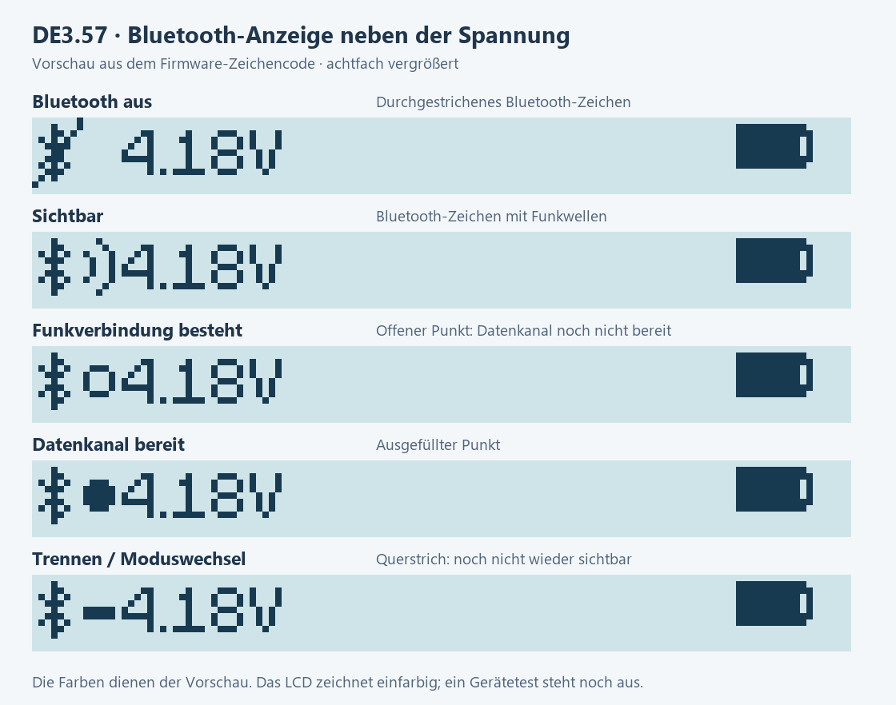
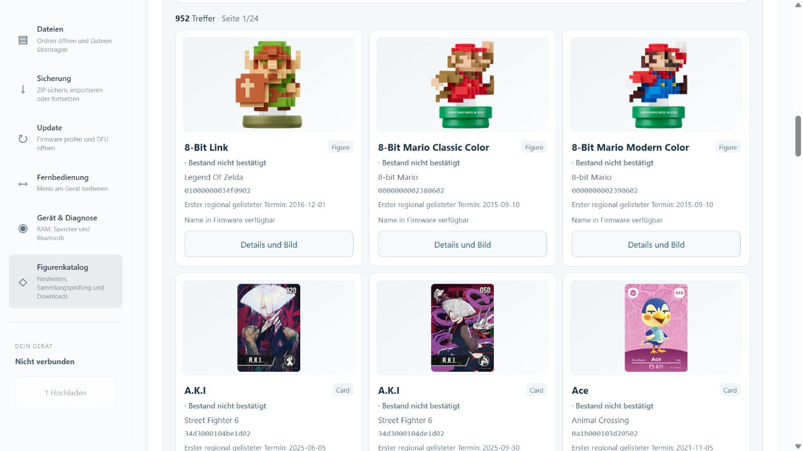
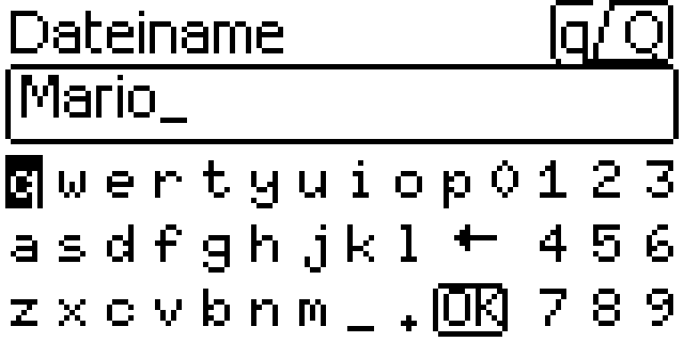

# Veröffentlichungen für Allmiibo LCD und Pixl.js OLED

## Dateimanager 3.67.1 · 26. November 2026

Bei Noah und Mio nennt der Figurenkatalog jetzt die deutschen Spielnamen der Kostüme und die Varianten ohne Jacke. Für Xenoblade Chronicles 3 – Nintendo Switch 2 Edition führt er Nintendos Termin am 3. Dezember 2026 und die bestätigte amiibo-Unterstützung auf. [GitHub](https://github.com/bluecyber81/pixl.js/releases/tag/web3.67.1)

## Dateimanager 3.67.0 · 26. November 2026

Der Dateimanager bündelt beim Ordnervergleich die Prüfsummen kleiner Dateien auf unterstützten LCDs. Der Figurenkatalog lädt bei Bedarf und ergänzt acht deutsch-englische Spielhinweise. Für lange Dateinamen gibt es Kurzvorschläge. Der Umstiegsassistent kann den Platzbedarf direkt für App680 prüfen. [GitHub](https://github.com/bluecyber81/pixl.js/releases/tag/web3.67.0)

## LCD DE4.2 / App680 · Final · 25. November 2026

Der Besitzer hat App680 auf seinem LCD getestet und als final bestätigt. Das Paket enthält dieselbe signierte App wie DE4.2-b2. Unter **Gerät & Diagnose** erscheint daher **2.22.0-DE4.2-b2**, App-Zähler **680**. Wer diesen Stand bereits nutzt, braucht kein weiteres Update. Die App ist für ST7567-LCD mit PFS1, Z21 und S112 7.3.0 vorgesehen. PFS1 grenzt die Dateisuche nach dem übergeordneten Ordner ein. Eine vorhandene Manifestdatei wird in einer LittleFS-Transaktion aktualisiert. Bei Platzmangel prüft die Firmware vor einem neuen Versuch, welche Fassung bereits gespeichert wurde. [Handy-ZIP](https://github.com/bluecyber81/pixl.js/releases/download/de4.2/Allmiibo_LCD_DE4_2_App680_NUR_APP.zip) · [Prüfpaket](https://github.com/bluecyber81/pixl.js/releases/download/de4.2/Allmiibo_LCD_DE4_2_App680_Pruefpaket.zip)

## Dateimanager 3.66.3 · 25. November 2026

Die normale Homepage und die Windows-Ausgabe bieten DE4.2 / App680 als reguläres LCD-Update an. Die getrennte OLED-Auswahl führt zu DE3.87 Test 6 / App86. Auf unterstützten LCDs liest der Dateimanager kleine Dateien gruppenweise. Die Auswahl **Schnellübersicht** im Figurenkatalog liest nur die Verzeichnisse, **Dateiinhalte prüfen** liest die passenden BIN-Dateien. [Dateimanager](https://bluecyber81.github.io/pixl.js/) · [Windows-Portable](https://github.com/bluecyber81/pixl.js/releases/download/web3.66.3/Allmiibo_Dateimanager_3_66_3_Portable.zip) · [Web-Release](https://github.com/bluecyber81/pixl.js/releases/tag/web3.66.3)

## Dateimanager 3.66.2 · 25. November 2026

Die normale Homepage und die Windows-Ausgabe bündeln kleine Dateien beim Lesen auf unterstützten LCDs. Beim Hochladen können neue Unterordner in bestehende Verzeichnisse eingefügt und unterbrochene Aufträge fortgesetzt werden. Das LCD-Web-DFU verwendet ausgehandelte Schreibgrößen und prüft die Bestätigungen des Bootloaders. DE4.1/App678 bleibt vorausgewählt. Die getrennte OLED-Auswahl behält ihre Übertragungseinstellungen. [Bedienung und Änderungen](web/LIESMICH_3_66_2.txt) · [optionale LCD-Beta App680](https://github.com/bluecyber81/pixl.js/releases/tag/de4.2-b2-lcd-transfer-test)

## LCD DE4.1 / App678 · Final · 25. November 2026

Die reguläre LCD-Version übernimmt das Weckprofil aus App677 samt bestätigtem Löschen und erneutem Speichern nach Fehlern. Bildempfang, Player und der mobile Lauftext sind verfügbar. Dateimanager 3.66.1 unterstützt die neue Versionsnummer auch bei Diagnose und Dateizugriff. Die signierte Handy-ZIP aktualisiert die Anwendung auf einem LCD mit PFS1, Z21 und S112 7.3.0. Die Gerätebestätigung vom 24. November gilt für den Vorgänger App677. [Handy-ZIP](https://github.com/bluecyber81/pixl.js/releases/download/de4.1/Allmiibo_LCD_DE4_1_678_NUR_APP.zip) · [Versionshinweise](docs/DE4_1_RELEASE.md) · [Prüfpaket](https://github.com/bluecyber81/pixl.js/releases/download/de4.1/Allmiibo_LCD_DE4_1_App678_Pruefpaket.zip)

## Dateimanager 3.66.0 und LCD-Testversion DE3.104 / App677

Lauftext am Handy eingeben, als Vorschau abspielen, ans LCD senden oder für den Animationsplayer speichern. Bei Minerus Konstrukt stehen die von Nintendo beschriebenen Belohnungen für drei Zelda-Spiele. Auf einem OLED mit Test 6 wurden Fernverbindung und Displayfoto bestätigt. Die optionale LCD-App677 kann das lokale Switch-2-Weckprofil nach Rückfrage entfernen und den automatischen Tastenstart ausschalten.

[Bildsender öffnen](https://bluecyber81.github.io/pixl.js/?workspace=stream) · [LCD-Testversion fürs Handy](https://bluecyber81.github.io/pixl.js/firmware/Allmiibo_LCD_DE3_104_677_NUR_APP.zip) · [Reguläre LCD-App675](https://github.com/bluecyber81/pixl.js/releases/tag/de3.102)

## LCD DE3.89 / App662 · stabile Firmware

| Dein LCD-Gerät | Passender Download |
| --- | --- |
| Packed LittleFS (PFS1), Z21 und S112 7.3.0 sind installiert | [Nur die App fürs Handy (ZIP)](https://github.com/bluecyber81/pixl.js/releases/download/de3.89/Allmiibo_LCD_DE3_89_662_NUR_APP.zip) |
| Ein kompatibles LCD braucht Z21 und S112 7.3.0 | [Zweistufiges Android-Komplettpaket mit App662 (ZIP)](https://github.com/bluecyber81/pixl.js/releases/download/de3.89/Allmiibo_LCD_S112_7_3_0_Z21_DE3_89_662_KOMPLETT.zip). Voraussetzung sind ein Bootloader-Zähler unter 21, der passende Schlüssel und das passende Speicherlayout. |
| Du möchtest die Firmware prüfen | [Prüfpaket mit BIN, HEX und Nachweisen](https://github.com/bluecyber81/pixl.js/releases/download/de3.89/Allmiibo_LCD_DE3_89_App662_Pruefpaket.zip) |

Sichere deine Dateien und wähle die gepackte ZIP in **nRF Device Firmware Update** aus. Für Geräte mit SPIFFS oder unbekanntem Dateisystem folge zuerst der [Migrationsanleitung](docs/MIGRATION_PFS1.md). [Flashanleitung](https://bluecyber81.github.io/pixl.js/guide/#flash)

Am 19. November 2026 bestätigte der Besitzer den erfolgreichen Praxistest auf seinem LCD. Der Dateimanager 3.58.2 las App662, die passende LCD-Buildkennung, Z21 und S112 7.3.0 aus. Der Zeitvergleich mit Mochi auf App662 und die Wiederaufnahme eines unterbrochenen Android-Firmwareupdates sind noch offen. [Gerätenachweis](docs/validation/DE3_89_LCD_READBACK.json)

## Dateimanager 3.58.2

Vorschau, Prüfung und Sicherung kleiner Dateien können diese mit einer einzigen Anfrage auslesen. Bei einer erneuten Suche prüft der Browser, ob sich der Speicher seit der letzten Suche geändert hat. Einen unterbrochenen Ordnerupload kannst du im selben Tab nach dem Wiederverbinden fortsetzen. [Dateimanager öffnen](https://bluecyber81.github.io/pixl.js/) · [Windows-Paket und Quellcode](https://github.com/bluecyber81/pixl.js/releases/tag/web3.58.2)

## OLED DE3.87 Test 6 und Dateimanager 3.58.1

Die OLED-Vorabversion verbessert die Auffindbarkeit der Fernbedienung, die Abstufung des SH1106-Kontrasts und das Speichern in der Figurendatenbank. Nach einem Lesefehler behält AmiiboLink den aktiven Slot. SPIFFS und natives LittleFS wurden auf simuliertem Flash geprüft. Am 18. November 2026 bestätigte ein Tester die Fernverbindung und den Abruf des Displayfotos auf einem OLED mit Test 6. Die Aufnahmen zeigen die Kontrast-Sollwerte 5 % und 100 %. Wie deutlich sich die Helligkeit am Panel änderte, blieb offen. [OLED-App fürs Handy](https://github.com/bluecyber81/pixl.js/releases/download/de3.87-oled-t6/Allmiibo_OLED_DE3_87_Test6_APP.zip) · [Deutsche Anleitung](https://github.com/bluecyber81/pixl.js/releases/download/de3.87-oled-t6/ANLEITUNG_OLED_Test6_DE.txt) · [Prüfpaket](https://github.com/bluecyber81/pixl.js/releases/download/de3.87-oled-t6/Allmiibo_OLED_DE3_87_Test6_Pruefpaket.zip)

Im Dateimanager lässt sich die signierte OLED-App über den Computer übertragen. Für das LCD mit PFS1, Z21 und S112 7.3.0 ist DE3.87/App660 als Vorabversion verfügbar. Bei Erscheinen dieser Version war DE3.81/App654 die reguläre LCD-Firmware. [Web-Downloads](https://github.com/bluecyber81/pixl.js/releases/tag/web3.58.1) · [Firmwarewahl](docs/COMPONENT_DOWNLOADS.md)

## Dateimanager 3.55.8

OLED DE3.84 Test4 / App84 lässt sich am Computer direkt im Browser flashen. Zielauswahl, vorausgewählte ZIP, Größen-/Hashprüfung und Übernahme aktueller Bootdaten sind integriert. Die Anleitung ist auf Deutsch und Englisch verfügbar.

## Dateimanager 3.55.6

Unter **Gerät & Diagnose** kann der Dateimanager bei App657 die Buildkennung der laufenden App, eine gegebenenfalls erhaltene Fehlernotiz vom vorigen Start und die beim letzten Mount belegten Cache-Seiten anzeigen. Der zweisprachige Prüfassistent bietet 40 zusätzliche LCD-Prüffälle. [Dateimanager öffnen](https://bluecyber81.github.io/pixl.js/) · [Windows-Paket und Quellcode](https://github.com/bluecyber81/pixl.js/releases/tag/web3.55.6)

## LCD DE3.84 / App657 · am Gerät erprobte Testversion

Die Spiele übernehmen die 180°-Drehung und haben eine deutsche und englische Bedienhilfe. Unter **Einstellungen** lassen sich das automatische Dimmen sowie der Display- und Tastentest aufrufen. Der Besitzer eines LCD meldete am 17. November 2026 erfolgreiche praktische Tests mit installiertem Z21. Welche Einzelfälle er getestet hat, ist offen. Die Wiederaufnahme nach einem echten Android-DFU-Abbruch ist gesondert zu prüfen.

Für ein Allmiibo LCD mit ST7567, Packed LittleFS (PFS1), Z21 und S112 7.3.0 die ZIP gepackt in **nRF Device Firmware Update** auswählen. [App-ZIP fürs Handy](https://github.com/bluecyber81/pixl.js/releases/download/de3.84-lcd-test1/Allmiibo_LCD_DE3_84_657_NUR_APP.zip) · [Prüfpaket mit Quellen, ELF und Maps](https://github.com/bluecyber81/pixl.js/releases/download/de3.84-lcd-test1/Allmiibo_LCD_DE3_84_App657_Pruefpaket.zip) · [GitHub-Prüflauf](https://github.com/bluecyber81/pixl.js/actions/runs/44047724527)

## DE3.81 / App654 · Z21 · Dateimanager 3.55.5

Für LCD ist DE3.81 / App654 die aktuelle Firmware. Mit eingerichtetem Packed LittleFS (PFS1), S112 7.3.0 und Z19, Z20 oder Z21 genügt die [App-ZIP](https://github.com/bluecyber81/pixl.js/releases/download/de3.81/Allmiibo_LCD_DE3_81_654_NUR_APP.zip). Für ein kompatibles LCD mit älterem Bootloader enthält das [Android-Komplettpaket](https://github.com/bluecyber81/pixl.js/releases/download/de3.81/Allmiibo_LCD_S112_7_3_0_Z21_DE3_81_654_KOMPLETT.zip) S112 7.3.0, Z21 und App654. [Installationsanleitung für LCD](https://bluecyber81.github.io/pixl.js/guide/index.html#flash) · [Separate OLED-Testversion](https://bluecyber81.github.io/pixl.js/guide/index.html#oled)

## Archiv · Dateimanager 3.55.4

Die Firmware-Auswahl und die Anleitung führen zum passenden Paket für das eigene Gerät. Bei Veröffentlichung von 3.55.4 standen DE3.75 Final und die Vorschau DE3.81 zur Wahl. Das OLED-Testpaket DE3.81 für S112 7.2.0 wird am Handy als App-Update installiert. [LCD-Freigabe](https://github.com/bluecyber81/pixl.js/releases/tag/de3.75) · [OLED-Testversion und Anleitung](https://github.com/bluecyber81/pixl.js/releases/tag/de3.81-oled-t1) · [Dateimanager 3.55.4](https://github.com/bluecyber81/pixl.js/releases/tag/web3.55.4)
Im Fernbedienungsfenster wird eine geschlossene Geräteauswahl erklärt. Eine Warnung über einen möglicherweise angekommenen Tastendruck erscheint nur bei einer gesendeten Aktion ohne Quittung. [OLED-Fernbedienung einrichten](https://bluecyber81.github.io/pixl.js/guide/index.html#oled-remote)

## DE3.81 / App654 · Z21 · Web 3.55.3

Im Akkuverlauf unter **Gerät & Diagnose** siehst du Messdauer, Spannweite und Unterbrechungen. Der erste neue Messwert nach einer Pause markiert die Fortsetzung. Der CSV-Export enthält den Pausengrund in der fünften Spalte `pause_reason`. [Dateimanager öffnen](https://bluecyber81.github.io/pixl.js/) · [Windows-Paket und Quellcode](https://github.com/bluecyber81/pixl.js/releases/tag/web3.55.3)

DE3.81 / App654 hält die markierte Figur bei einem abgelehnten Wechsel und ermöglicht einen neuen Versuch, wenn AmiiboLink keine Tagdaten erzeugen kann. Z21 zeigt beim Fortsetzen einer DFU-Übertragung wieder den Empfang an. Auf einem LCD hat der Besitzer den Flash und die erste Funktion bestätigt. Die Wiederaufnahme nach einem echten Funkabbruch ist offen. [App654](https://github.com/bluecyber81/pixl.js/releases/download/de3.81/Allmiibo_LCD_DE3_81_654_NUR_APP.zip) · [Android-Kombi mit S112 7.3.0 und Z21](https://github.com/bluecyber81/pixl.js/releases/download/de3.81/Allmiibo_LCD_S112_7_3_0_Z21_DE3_81_654_KOMPLETT.zip) · [Quellen und Prüfnachweise](https://github.com/bluecyber81/pixl.js/releases/download/de3.81/Allmiibo_LCD_DE3_81_Z21_Pruefnachweise.zip)

## Web 3.53.0 · 15.11.2026

Ordnersicherungen lassen sich mit einer früheren ZIP beschleunigen. Der Dateimanager vergleicht kleine Dateien mit der aktuellen Prüfsumme vom Gerät. Du kannst die ZIP komprimieren, die Dauer je Sicherungsphase sehen und einen gesicherten Figurenordner offline prüfen. Beim Umbenennen und vor dem ZIP-Import wird die verbleibende Pfadlänge angezeigt. Unter Gerät & Diagnose lassen sich MIFARE-Mini-Slots lesend prüfen.

## DE3.75 / App648 · Web 3.52.1

**DE3.75 / App648 war die damalige stabile LCD-Firmware** für Geräte mit PFS1, Z19 und S112 7.3.0. Auf einem LCD gelangen die Rückkehr zur gewählten Figur und das Aufwachen in beiden Apps. Die Switch erkannte außerdem eine bekannte Figur. Wer die signierte App648 bereits geflasht hat, kann sie weiterverwenden. [App-ZIP fürs Handy](https://github.com/bluecyber81/pixl.js/releases/download/de3.75/Allmiibo_LCD_DE3_75_648_NUR_APP.zip) · [Android-Kombi für passende ältere Bootloader](https://github.com/bluecyber81/pixl.js/releases/download/de3.75/Allmiibo_LCD_S112_7_3_0_Z19_DE3_75_648_KOMPLETT.zip) · [Änderungen und Gerätetests](docs/RELEASE_DE3_75.md)

## DE3.74 / App647 und Dateimanager 3.50.0

**Finale LCD-Version.** Am 14. November 2026 bestätigte der Besitzer, dass das Displayfoto in der Fernbedienung auf seinem Allmiibo LCD mit DE3.74 und Dateimanager 3.50.0 funktioniert. Der Diagnoseexport weist App647, Bootloader Z19 und SoftDevice S112 7.3.0 aus. [Firmwarefreigabe](https://github.com/bluecyber81/pixl.js/releases/tag/de3.74)

Unter **Fernbedienung → Displaybild aktualisieren** zeigt das Handy das aktuelle Gerätemenü. Du kannst das Bild drehen, als PNG speichern und nach dem nächsten Tastendruck erneut aufnehmen. Aktiviere dazu am wachen LCD-Allmiibo die BLE-Fernbedienung und verbinde **Pixl.Remote**. DE3.74 fügt die Fotoaufnahme hinzu. Auch auf DE3.73 kannst du mit **Verbindung prüfen** die Uhrzeit der letzten angeforderten Geräteantwort sehen. Ein abgebrochener Verbindungsversuch kann eine neu aufgebaute Dateiübertragung nicht mehr versehentlich trennen.

[Signierte Android-DFU-ZIP für LCD mit PFS1, Z19 und S112 7.3.0](https://github.com/bluecyber81/pixl.js/releases/download/de3.74/Allmiibo_LCD_DE3_74_647_NUR_APP.zip) · [Dateimanager 3.50.0](https://github.com/bluecyber81/pixl.js/releases/tag/web3.50.0)

## Dateimanager 3.49.0

Auf dem iPhone erklärt der Dateimanager die Möglichkeiten für Katalog und Bluetooth. Beim erneuten Ordnerabgleich lassen sich Änderungen auf beiden Seiten erkennen. Für Geräte mit cylin577s Firmware gibt es einen eigenen PixLink-Zugang. [Veröffentlichung und Downloads](https://github.com/bluecyber81/pixl.js/releases/tag/web3.49.0)

## Dateimanager 3.48.4

Bei der Online-Katalogprüfung zeigt der Dateimanager an, wenn Spielhinweise oder Schreibangaben in der Quelle fehlen. Die geprüften Spielhinweise bleiben verfügbar. Die Fernbedienung unterstützt die Tastatur und zeigt an, welchen Befehl das Gerät bestätigt hat. Für Dragoon und Hydra nennt die Dateiprüfung beide möglichen Maschinen, weil sie den gleichen Platinencode verwenden. [Veröffentlichung und Downloads](https://github.com/bluecyber81/pixl.js/releases/tag/web3.48.4)

## Dateimanager 3.48.3

Der Offline-Katalog umfasst 954 Figuren. Unter **Figurenkatalog → Spiel → Kirby Air Riders** findest du sieben Fahrer, darunter Kirby mit Schwert & Dragoon sowie Dedede Noir & Hydra. Beide lassen sich auch unter ihrem deutschen Namen finden. Der Firmware-Namensfilter umfasst die 952 IDs der veröffentlichten App646. [Windows ZIP](https://github.com/bluecyber81/pixl.js/releases/download/web3.48.3/Allmiibo_Dateimanager_3_48_3_Portable.zip) · [Source ZIP](https://github.com/bluecyber81/pixl.js/releases/download/web3.48.3/Allmiibo_Dateimanager_3_48_3_Quellcode.zip)

## DE3.72 / App645 und Dateimanager 3.48.1

Die LCD-Testanwendung merkt sich bei der Rückkehr den gewählten Datenplatz und die im Detail zuletzt angezeigte Figur. Vier deutsche und englische Spielhinweise zu Mipha und Urbosa wurden korrigiert. Im Dateimanager ist App645 jetzt auch für die lokale Platzprüfung auswählbar. [Änderungen und Prüfnachweise](https://github.com/bluecyber81/pixl.js/releases/tag/de3.72) · [Dateimanager öffnen](https://bluecyber81.github.io/pixl.js/)

| Ausgangslage beim LCD-Allmiibo | Passender Download |
| --- | --- |
| Packed LittleFS ist eingerichtet, Z19 und Nordic S112 7.3.0 sind vorhanden | [Nur die neue Gerätesoftware DE3.72](https://github.com/bluecyber81/pixl.js/releases/download/de3.72/Allmiibo_LCD_DE3_72_645_NUR_APP.zip) |
| Passendes nRF52832-LCD mit bekanntem Flashlayout und funktionierendem, signaturkompatiblem Secure DFU. Bootloaderzähler unter 19, S112-FWID 0x0103 oder 0x0126 | [Komplettpaket mit S112 7.3.0, Z19 und DE3.72](https://github.com/bluecyber81/pixl.js/releases/download/de3.72/Allmiibo_LCD_S112_7_3_0_Z19_DE3_72_645_KOMPLETT.zip). Am Android-Handy mit **nRF Device Firmware Update** beide Phasen abschließen. |
| Altes SPIFFS-Laufwerk steht vor der Umstellung | [Vorbereitungsfirmware DE3.30-PREP / 600](https://github.com/bluecyber81/pixl.js/releases/download/de3.72/Allmiibo_LCD_SPIFFS_DE3_30_PREP_600.zip). Zuerst die Originaldateien sichern. Vor dem Systemwechsel die vollständige Raw128-Sicherung frisch vergleichen und die Platzprüfung bestehen. [Schritt für Schritt zu LittleFS](https://bluecyber81.github.io/pixl.js/guide/#littlefs) |

Die Anleitung nennt die Geräte- und Zählervoraussetzungen. Die Einrichtung von LittleFS löscht das alte Laufwerk E:. Anschließend die bestätigte Sicherung wiederherstellen und vollständig am Ziel vergleichen. [Alle Installationswege](https://bluecyber81.github.io/pixl.js/guide/) · [Windows, Quellen und ChatGPT-Prüfpaket](https://github.com/bluecyber81/pixl.js/releases/tag/web3.48.1)

## Dateimanager 3.48.0 und LCD-Testfirmware DE3.71t1

Der Dateimanager schützt fertige Sicherungs-ZIPs vor versehentlichem Schließen. ZIP-Vergleiche lassen sich filtern und als CSV oder JSON exportieren. Favoriten und Suchfilter können in einen anderen Browser übernommen werden. Unter Windows funktioniert jetzt auch das Beenden des Hintergrundservers nach einer bestätigten Stoppanforderung.

Beim Gerätetest mit App644 kehrte die Auswahl auf den ausprobierten Wegen im Datei-Emulator und in der Amiibo-Datenbank zur richtigen Figur zurück, sowohl bei „Zurück zur Liste“ als auch nach dem Aufwachen. Die Testfirmware ist ein signiertes App-Update für passende LCD-Geräte mit Packed LittleFS. [Dateimanager öffnen](https://bluecyber81.github.io/pixl.js/) · [Versionshinweise und Downloads](https://github.com/bluecyber81/pixl.js/releases/tag/web3.48.0) · [LCD-Testfirmware](https://github.com/bluecyber81/pixl.js/releases/tag/de3.71t1)

## Dateimanager 3.47.0

Der Amiibo-Emulator sortiert die sichtbare Seite im Figurenordner einmal. Unter **Gerät & Diagnose → Alle Diagnosewerte auslesen** zeigt der Dateimanager mit DE3.70 die erkannten Mitteltastenereignisse bis zur ersten Auswahl im Hauptmenü und die Dauer des App-Aufrufs. Die Daten bleiben bis zum Neustart im RAM. [LCD DE3.70 (ZIP)](https://bluecyber81.github.io/pixl.js/firmware/Allmiibo_LCD_DE3_70_642_NUR_APP.zip) · [Web 3.47.0](https://github.com/bluecyber81/pixl.js/releases/tag/web3.47.0)

## Dateimanager 3.46.0

Unter **Sicherung** kannst du zwei gespeicherte Sicherungs-ZIPs auswählen. Die Ansicht zeigt neue, entfernte und geänderte Einträge. Der Vergleich läuft auch bei getrenntem Gerät. Unter **Update** öffnet „In nRF DFU öffnen“ das gewählte öffentliche LCD-Paket auf Android. Die LCD-Testversion DE3.69 zeigt die letzten fünf geöffneten Figuren in der Amiibo-Datenbank. [DE3.69 LCD (ZIP)](https://bluecyber81.github.io/pixl.js/firmware/Allmiibo_LCD_DE3_69_641_NUR_APP.zip) · [Web 3.46.0](https://github.com/bluecyber81/pixl.js/releases/tag/web3.46.0)

## Dateimanager 3.45.0 · LCD DE3.68 / 640 · 2026-11-09

Im Figurenkatalog kannst du ein Spiel auswählen und die passenden Figuren aus deiner Sammlung anzeigen. Unter Sicherung zeigt der Ordnervergleich auch die Dateien, die nur auf dem Gerät liegen. Die LCD-Testversion DE3.68 merkt sich beim Zurückkehren ins Hauptmenü die zuletzt geöffnete App. Im Dateimanager lässt sich jedem verbundenen Gerät ein eigener Name für diesen Browser geben. Beim Gerätewechsel erscheint der jeweils zugeordnete Name. [DE3.68 LCD (ZIP)](https://bluecyber81.github.io/pixl.js/firmware/Allmiibo_LCD_DE3_68_640_NUR_APP.zip) · [Web 3.45.0](https://github.com/bluecyber81/pixl.js/releases/tag/web3.45.0)

## Dateimanager 3.44.0 · 8. November 2026

Beim Öffnen wählt der Dateimanager die erste unterstützte Sprache aus der Sprachliste des Browsers. Im Sprachmenü kannst du eine feste Sprache wählen oder wieder zur automatischen Auswahl wechseln.

Auch der Firmware-Updater, die Anleitung und die Downloadseite verstehen Deutsch und Englisch. In der englischen Oberfläche erscheinen die Katalogfehler, Berichtsdateinamen und Regionsnamen jetzt auf Englisch. Eigene Dateien und Figuren werden dadurch nicht umbenannt.

- **3.44.0** · [Web-Quellcode (ZIP)](https://github.com/bluecyber81/pixl.js/releases/download/web3.44.0/Allmiibo_Dateimanager_3_44_0_Quellcode.zip) · [ChatGPT-Prüfpaket (ZIP)](https://github.com/bluecyber81/pixl.js/releases/download/web3.44.0/Allmiibo_DE3_67_Z19_Web3_44_0_ChatGPT_Pruefpaket.zip)

## Dateimanager 3.43.1 · 8. November 2026

Die lokale LittleFS-Platzprüfung zeigt DE3.67 mit App-Zähler 639 als neueste geprüfte Firmware. Das Speicherprofil gilt für DE3.55 bis DE3.67.

- **3.43.1** · [Web-Quellcode (ZIP)](https://github.com/bluecyber81/pixl.js/releases/download/web3.43.1/Allmiibo_Dateimanager_3_43_1_Quellcode.zip) · [ChatGPT-Prüfpaket (ZIP)](https://github.com/bluecyber81/pixl.js/releases/download/web3.43.1/Allmiibo_DE3_67_Z19_Web3_43_1_ChatGPT_Pruefpaket.zip)

## Dateimanager 3.43.0 und LCD-Testversion DE3.67 · 8. November 2026

Ordnersicherungen lassen sich nach einem Browserneustart fortsetzen. Der Figurenkatalog speichert Webfavoriten, benannte Filter und HTTPS-Linklisten. LCD-Displayfotos kannst du vor dem Speichern um 180° drehen. [Bedienung](docs/DATEIMANAGER_WEB.md#dateimanager-3430)

**LCD-Testversion DE3.67 / 639.** Alle 54 unterschiedlichen Spielhinweise für 63 Spielzuordnungen lassen sich am Gerät auf Deutsch lesen. Lange Hinweise scrollen bis zum letzten Bildpunkt. Deutsche Spielhinweise und QR-Code wurden am LCD bestätigt. Den letzten Scrollpixel deckt der Rendertest am Rechner ab. [Android-Download](https://bluecyber81.github.io/pixl.js/firmware/Allmiibo_LCD_DE3_67_639_NUR_APP.zip)

- **3.43.0** · [Web-Quellcode (ZIP)](https://github.com/bluecyber81/pixl.js/releases/download/web3.43.0/Allmiibo_Dateimanager_3_43_0_Quellcode.zip) · [ChatGPT-Prüfpaket (ZIP)](https://github.com/bluecyber81/pixl.js/releases/download/web3.43.0/Allmiibo_DE3_67_Z19_Web3_43_0_ChatGPT_Pruefpaket.zip)

## Dateimanager 3.42.2 · 8. November 2026

Die bebilderten Schaltflächen für Figurenimport und Firmwareupdate nehmen oben weniger Platz ein. Beide bleiben direkt antippbar. Am Handy kannst du für 3.42.2 und 3.42.1 jeweils den Web-Quellcode oder das ChatGPT-Prüfpaket herunterladen. [Web 3.42.2](https://github.com/bluecyber81/pixl.js/releases/tag/web3.42.2) · [Bedienung](docs/DATEIMANAGER_WEB.md#dateimanager-3422)

- **3.42.2** · [Web-Quellcode (ZIP)](https://github.com/bluecyber81/pixl.js/releases/download/web3.42.2/Allmiibo_Dateimanager_3_42_2_Quellcode.zip) · [ChatGPT-Prüfpaket (ZIP)](https://github.com/bluecyber81/pixl.js/releases/download/web3.42.2/Allmiibo_DE3_66_Z19_Web3_42_2_ChatGPT_Pruefpaket.zip)
- **3.42.1 (Vorgängerversion)** · [Web-Quellcode (ZIP)](https://github.com/bluecyber81/pixl.js/releases/download/web3.42.1/Allmiibo_Dateimanager_3_42_1_Quellcode.zip) · [ChatGPT-Prüfpaket (ZIP)](https://github.com/bluecyber81/pixl.js/releases/download/web3.42.1/Allmiibo_DE3_66_Z19_Web3_42_1_ChatGPT_Pruefpaket.zip)

## Dateimanager 3.42.1 · 8. November 2026

Auf dem Handy führen die bebilderten Schaltflächen direkt zu Figurenimport und Firmwareupdate. Die sechs Bereiche haben eigene Farbakzente. „Dein Gerät“ zeigt den aktuellen Ordner und die Speicherbelegung mit einem breiten Verlaufsbalken. Der Figurenimport öffnet sich jetzt auch beim ersten Klick, wenn der Browser die Ansicht noch lädt. Die Anleitung beschreibt zusätzlich Nordics PC-Weg für Bluetooth-DFU mit einem passenden Adapter. [Web 3.42.1](https://github.com/bluecyber81/pixl.js/releases/tag/web3.42.1) · [Bedienung](docs/DATEIMANAGER_WEB.md#dateimanager-3421)

## Dateimanager 3.42.0 · 8. November 2026

Die Startseite führt direkt zum Figurenimport oder zum Firmwareupdate. Bei blockierten Downloads kannst du die Quelle separat öffnen und die gespeicherte BIN prüfen. Treffer in der Gerätesuche lassen sich direkt herunterladen. Den geprüften Bestand kannst du als CSV für Excel speichern. [Web 3.42.0](https://github.com/bluecyber81/pixl.js/releases/tag/web3.42.0) · [Bedienung](docs/DATEIMANAGER_WEB.md#dateimanager-3420) · [Anleitung: Flashen, Bootloader und LittleFS](https://bluecyber81.github.io/pixl.js/guide/index.html)

## Dateimanager 3.41.0 · 7. November 2026

Im Figurenkatalog lässt sich für jede Figuren-ID ein eigener direkter HTTPS-Link zur BIN-Datei hinterlegen. Nach dem Speichern genügt ein Klick auf den Figurennamen. Der Browser prüft Größe, Grundstruktur und Figuren-ID vor dem Download. [Web 3.41.0](https://github.com/bluecyber81/pixl.js/releases/tag/web3.41.0) · [Bedienung](docs/DATEIMANAGER_WEB.md#dateimanager-3410)

## Dateimanager 3.40.1 · 7. November 2026

Die Paketkarte wählt die gewünschte Firmware im Updater vor. Ein Wechsel der Auswahl verwirft die zuvor geladene ZIP. Im Katalog lassen sich auch die drei Serien mit ausschließlich angekündigten Figuren filtern. Nach einer Sicherung sind frisch gelesene und wiederverwendete Dateien getrennt ausgewiesen. [Bedienung](docs/DATEIMANAGER_WEB.md#dateimanager-3401) · [Geräteprüfung einschließlich Android-Sicherung](docs/validation/DE3_66_LCD_READBACK.md)

## DE3.66 / 638 und Dateimanager 3.40.0 · 7. November 2026

Die LCD-Testversion liefert das aktuelle Displaybild und kann beim Fortsetzen einer Sicherung Dateien bis 572 Byte auf E: direkt per SHA-256 vergleichen. Web 3.40.0 ergänzt neun Figurenankündigungen, die Bildvorschau in der Gerätesuche und die Restzeitschätzung beim Firmware-Update. Der Bestandsabgleich umfasst 952 bestätigte Figuren-IDs. DE3.65 / 637 ist die am LCD geprüfte stabile App mit Z19 und Nordic S112 7.3.0. Am LCD sind Displayfoto, Tastendruck, Menü und NFC an der Switch bestätigt. Eine unterbrochene Sicherung wurde am Windows-Laptop und in Android-Chrome fortgesetzt. [Menüwege und Paketauswahl](docs/RELEASE_DE3_66.md) · [Web-Downloads](https://github.com/bluecyber81/pixl.js/releases/tag/web3.40.0)

[Geräte-Firmware und Bootloader](docs/VERSIONEN_FIRMWARE.md) · [Alle dokumentierten Dateimanager-Versionen](docs/VERSIONEN_WEB.md)

## DE3.65 final und Dateimanager 3.39.5

Der Abgleich erklärt auf Deutsch und Englisch, wann sich eine Datei seit dem Vergleich geändert hat und wie man den Vergleich wiederholt. Die Sicherung nennt die Grenzen der Wiederaufnahme. Der Web-Updater und der Handy-Download verwenden dieselbe App 637. Das Gerät wurde mit Z19 und Nordic S112 7.3.0 ausgelesen. [LCD](docs/validation/DE3_65_LCD_READBACK.json) · [Web](docs/RELEASE_WEB3_39_5.de.md)

# DE3.65 / 637 und Dateimanager 3.39.4

Der Scrollbalken der LCD-App zeigt das Ende einer dreizeiligen Notiz an. Die Katalogtabelle spart gegenüber DE3.64 netto 2.672 Byte Programmflash. Der Dateimanager erleichtert die Korrektur von Dateinamen, übersetzt 54 Spielhinweise ins Deutsche und kann das Display auf der DFU-Seite wach halten. Für den geprüften Z19/636-Ausgangsstand gibt es eine signierte App-ZIP. [App und Nachweise](https://github.com/bluecyber81/pixl.js/releases/tag/de3.65) · [Dateimanager](docs/RELEASE_WEB3_39_4.de.md)

# Dateimanager 3.39.3 · DFU-Abschluss und Dateinamen

Dateimanager 3.39.3 meldet nach einem bestätigten Firmwaretransfer ausdrücklich, wenn der Browser die Bluetooth-Trennung angefordert hat. Beim Hochladen, Synchronisieren oder Umbenennen nennt die Fehlermeldung jetzt den zu langen Namen oder Pfad, seine Größe in UTF-8-Bytes und die zulässige Länge. Der Neustart lässt sich nach der Rückkehr ins Hauptmenü unter **Gerät & Diagnose** anhand der ausgelesenen Version prüfen. [Bedienung und Prüfnachweise](docs/RELEASE_WEB3_39_3.de.md)

---

# DE3.63 / 635 · Dateimanager 3.39.2

**Amiibo-Datenbank → Figur öffnen → kurz Mitte → Notiz / Hinweise** macht persönliche Notiz und Spielhinweis unabhängig erreichbar. Kurz links/rechts wechselt zwischen den beiden Seiten, Halten scrollt in ganzen Textzeilen, Mitte kehrt zum Menü zurück. Dasselbe Menü ist in der Datenbank-Slotansicht vorhanden. Die Informationsseiten verändern weder Tagdaten noch Notizen, Schreibschutz oder Spielstände.

Acht bereits im Dateimanager vorhandene deutsche Übersetzungen für 13 Katalogzuordnungen sind nun auch in der Firmware verfügbar. Die Auswahl erfolgt anhand des exakten englischen Quelltextes; andere vorhandene Texte bleiben Englisch. Der Spielhinweis hängt vom ausgewählten Datenbankspiel ab. Ein fehlender Hinweis ist keine Aussage zur Spielkompatibilität.

**LCD-Darstellung korrigiert:** Die bisher im Produktionsfont fehlenden Großumlaute **Ä, Ö und Ü** sind ergänzt. Dadurch lassen sich auch persönliche Notizen mit diesen Zeichen anzeigen. Die vorhandenen Zeichen bleiben erhalten; andere nicht unterstützte Unicode-Zeichen werden damit nicht automatisch ergänzt.

Web 3.39.2 zeigt in Figurendetails und Dateivorschau neben „Kataloghinweise“ den eingebauten Datenstand. Die bisherigen Wachhalte-, Sicherungs- und Sammlungsfunktionen bleiben enthalten.

Das LCD/PFS1-Paket **Allmiibo_LCD_DE3_63_635_TESTSTAND.zip** aktualisiert nur die Anwendung. Bootloader, S112 und PFS1 werden nicht ersetzt; eine neue Migration oder Formatierung ist nicht erforderlich. Die Änderung verspricht keinen schnelleren Start. Die Geräteprüfung von DE3.63 und längerer Handy-/Bluetooth-Betrieb bleiben offen. Für Z17 zusammen mit DE3.62 liegt inzwischen ein Diagnoseexport mit positiver Nutzerrückmeldung vom 6. November 2026 vor; dies ersetzt nicht die Prüfung der neuen App. [Bedienung und Prüfgrenzen](docs/RELEASE_DE3_63.md) · [Build](docs/BUILD_DE3_63.md) · [Web](docs/RELEASE_WEB3_39_2.de.md)

---

# Web 3.39.1 · Display bei laufenden Vorgängen wach halten

Bei Sicherungen, Dateiübertragungen und längeren Geräteabfragen fordert die sichtbare Seite auf unterstützten Browsern eine Screen Wake Lock an. Die Anzeige meldet den tatsächlichen Zustand, lässt sich abschalten und bietet einen erneuten Versuch an. Die Sperre wird bei Abschluss, Trennung und Verlassen der App freigegeben; ein verdeckter Tab fordert sie nach Rückkehr neu an. Es gibt keine automatische Wiederholungsschleife nach einer Systemfreigabe.

Manuelles Sperren, Browser-Suspend und Energiesparen können Bluetooth weiterhin unterbrechen. Kein Live-Geräte- oder Android-Nachweis. App DE3.62/634, Z17 und S112 bleiben unverändert. [Details](docs/RELEASE_WEB3_39_1.de.md).

# Web 3.39.0 · App DE3.62 / 634 unverändert

Lokal vorbereiteter Browserstand vom 6. November 2026. Veröffentlichung, aktuelle Gerätesicherung und tatsächliche Hardwareprüfung sind separate, hier nicht bestätigte Schritte.

* **Figurendetails und Dateivorschau:** Kataloghinweise für 952 Figuren und 1.344 Zuordnungen. Acht deutsche Teilübersetzungen decken 13 Zuordnungen ab; weitere vorhandene Hinweise bleiben englisch. Zuordnungen sind keine Spielprüfung.
* **Sammlung prüfen:** Gleiche Figuren-ID und SHA-256-Dateigleichheit werden getrennt angezeigt. Der Vergleich nutzt bereits gelesene Bytes, ohne zusätzliche BLE-Lesezugriffe. Die Schnellprüfung behauptet keine Dateigleichheit; keine automatische Löschung.
* **Gerät & Diagnose → Karten-Slot lokal prüfen:** Lokale optionale Reparaturkopie nur für unterstützte MF0-Typen, passende v8-Konfiguration und `NN.bin`, bekanntes altes UID-Kopiermuster und gültige BCCs. Quelle bleibt erhalten; kein Geräteschreiben.
* **ZIP importieren:** Exakte inaktive OLD/NEW-Journaldateien werden sichtbar ausgeschlossen und im Archiv erhalten. Aktive/unklare Transaktionen sperren den gesamten Import; Quelle, Zielumleitung und frischer Zielzustand werden geprüft.

App **DE3.62 / 634**, Bootloader **Z17** und **S112 7.3.0** bleiben unverändert. [Benutzung und Prüfgrenzen](docs/RELEASE_WEB3_39_0.de.md).

# DE3.61 · Web 3.37.4

Das signierte Anwendungsupdate **DE3.61 / 633** ist für das nRF52832-Allmiibo LCD mit vorhandenem Packed LittleFS (PFS1) gedacht. Das eigene Gerät mit Z15 und S112 7.3.0 kann die App separat über Bluetooth erhalten. DE3.61 wurde am Rechner geprüft. Der erste Praxistest dieser App steht aus.

* **Einstellungen.** Die 21 Hauptoptionen und ihre Werte sind auf Deutsch und Englisch bei ausgeschalteter Menüanimation lesbar. „Fernsteuern“ zeigt „bis Aus“, wenn die Fernbedienung für diese Sitzung eingeschaltet ist. Die RAM-Anzeige berücksichtigt die tatsächlich gezeichnete Schrift bis zum rechten Displayrand.
* **Speicher beim Einschalten.** Im Test mit 1.131 Dateien und 77 Ordnern sank die Zahl der Lesezugriffe beim Einbinden von 4.712 auf 4.531. Der Dateimanager zeigt unter **Gerät & Diagnose → Startzeiten lesen**, wie lange das Einbinden, die Journalprüfung und der Rest des Speicherstarts jeweils brauchen.
* **Figurenkatalog.** Kürzere interne Verweise lassen 2.644 Byte mehr Flash für die Firmware frei. Alle 952 Figuren, 82 Spiele und 1.344 Spielzuordnungen samt Beschreibungstexten wurden im fertigen Programm verglichen.
* **Dateimanager 3.37.4.** Die Diagnose trennt die von der Firmware gemeldete ATT-MTU von der nutzbaren Größe eines Bluetooth-Datenpakets. Der Versionsvergleich kennt Z15 sowie den getrennt gekennzeichneten Rückkehrstand Z16 mit Z13-Code.

[LCD-Vergleich](docs/validation/DE3_61_LCD.png) · [Prüfergebnisse](docs/validation/DE3_61.json)

# DE3.60 · Web 3.37.3

**DE3.60 / 632** verbessert die Bedienung auf dem 128 × 64 Pixel großen LCD. Das signierte Update enthält die Geräte-App für ein nRF52832-Allmiibo mit Packed LittleFS (PFS1).

* **Bluetooth-Dateiübertragung.** Links oder rechts wechselt einmal auf den QR-Code, auch beim Halten. Der Code öffnet den Dateimanager auf GitHub Pages. Auf der Statusseite steht auch die Taste für den Rückweg.
* **Bildschirmtastatur.** Ein langer Mitteldruck auf einen Buchstaben schreibt einen Großbuchstaben. Bestätigen löst beim Halten einmal aus. Halten auf der Löschtaste löscht weiter. Das X bricht eine Eingabe ohne Speichern ab.
* **Einstellungen.** Kurze Werte wie AN und AUS bekommen rechts festen Platz. Lange Titel bleiben auch mit abgeschalteter Animation lesbar. Scheitert das Speichern, bleibt die Fehlermeldung bis zur Bestätigung stehen. Beim Kartenexport bleibt der eingegebene Name für einen erneuten Versuch erhalten.
* **Amiibo-Emulator → Dateimenü → mehrere Tags erstellen.** Das Display zeigt die aktuelle Datei und ihre Nummer. Mit „Abbrechen“ stoppst du zwischen zwei Dateien. Bereits geschriebene Dateien bleiben erhalten. Belegte Namen, voller Gerätespeicher und zu wenig RAM haben eigene Hinweise.
* **Dateimanager 3.37.3 → Firmware-Update.** Die Seite zeigt Übertragung, Prüfsummenvergleich und die Bestätigung des Abschlussbefehls als getrennte Schritte. Der tatsächliche Neustart lässt sich im normalen Menü bzw. durch erneutes Auslesen bestätigen.

## Dateimanager 3.37.3

Die DFU-Seite zeigt beim Anwendungsupdate, wann der Bootloader Daten empfängt, wann die Prüfsumme verglichen wird und wann er den Abschluss bestätigt. Nach seiner Bestätigung führt „Dateimanager öffnen“ zur erneuten Verbindung. Prüfe vorher am Allmiibo die gestartete Version. Bei einer unterbrochenen Übertragung bleibt der letzte bestätigte Byte-Stand sichtbar. [DFU-Anleitung](docs/DATEIMANAGER_WEB.md)

## Dateimanager 3.37.2

Wenn Bluetooth beim Hochladen einer Figur abbricht, zeigt der Dateimanager den betroffenen Speicherort und die ursprüngliche Sitzung an. Steht der Abschluss noch aus, verbinde dasselbe Gerät erneut und prüfe den Zielordner, bevor du den Upload wiederholst. Halte den Browsertab dafür geöffnet. Beim Gerätewechsel verschwinden die Erfolgs- und Fehlermeldungen des vorherigen Geräts. Hinweise auf zu prüfende Dateien bleiben bei ihrer ursprünglichen Sitzung. [GitHub Release](https://github.com/bluecyber81/pixl.js/releases/tag/web3.37.2)

## Dateimanager 3.37.1

Die Sammlungsprüfung und die Ordnersicherung zeigen, wie weit das Einlesen über Bluetooth ist. Beim Lesen zählt eine geschätzte Restzeit herunter. Beim Ordnervergleich der ZIP-Sicherung beginnt eine neue Schätzung für diesen Schritt. Die Gerätediagnose nennt den jeweils laufenden Bereich. Orange Katalogkarten erklären den konkreten Prüfhinweis zur Figur. Öffne den aktualisierten Dateimanager im Browser. [Web-Download](https://github.com/bluecyber81/pixl.js/releases/tag/web3.37.1)

## Firmware DE3.59 und Dateimanager 3.37.0

**DE3.59 / 631** ist ein Anwendungsupdate für das Allmiibo LCD mit nRF52832 und bestehendem Packed LittleFS (PFS1). **Dateimanager 3.37.0** funktioniert auch mit älteren Diagnoseberichten. Bootloader BL8, Nordic S112 7.3.0, Dateiformate und Katalog bleiben erhalten.

* **Schneller lesen beim Start.** Vier bereits vorhandene RAM-Seiten werden jetzt nach dem letzten Zugriff wiederverwendet. Beim Einbinden derselben nachgebildeten Sammlung (1.131 Dateien, 77 Ordner) sank die Anzahl der SPI-Lesezugriffe von 4.802 auf 4.712. Der temporäre Cache bleibt 1.032 Byte groß. Das ist ein Vergleich der Zugriffe, keine Stoppuhrmessung am Gerät.
* **Kartenemulator → Steckplätze → Anzahl der Plätze.** Scheitert die Speicherung, zeigt „Platzanzahl im RAM“, dass die Änderung noch nicht dauerhaft gesichert ist. Kurz Mitte versucht das Speichern erneut. Lang Mitte geht zurück und behält die ausstehende Änderung für einen späteren regulären Speichervorgang.
* **Gerät & Diagnose → Laufzeitdiagnose.** DE3.59 meldet den bisher unberührten Teil des reservierten Stacks. Unter **Startzeiten → Mehrere Kaltstarts auswerten** berechnet der Browser Median und Spannweite aus 3–20 Berichten derselben Firmware.
* **Einstellungen → Version → Source-ID.** Die zwölfstellige Quellkennung für diesen Build lautet `7b4822b045b4`. Beide unabhängigen Builds ergeben dasselbe Anwendungsprogramm. Der Katalogabgleich der fertigen Firmware umfasst 952 Figuren-IDs, 82 Spiele und 1.344 Zuordnungen.

**Am LCD-Gerät gemessen.** Bei je einem Start auf demselben Gerät brauchte der Speicher mit DE3.59 2.321 ms (DE3.58: 2.338 ms). Bis zur ersten Ereignisverarbeitung vergingen 2.426 ms (zuvor 2.443 ms). Beide Abschnitte waren in diesem Vergleich 17 ms kürzer. Bootloader und sichtbarer Displaystart liegen außerhalb der Messung. Bei der Bluetooth-Abfrage meldete die Firmware 5.240 von 8.192 Byte unberührten Stack und 10.644 Byte freien Heap. [Gerätemessung](docs/validation/DE3_59_READBACK.json)

Vorhandenes PFS1 braucht weder Formatierung noch erneuten Import. Nur die innere Firmware-ZIP flashen. Echte Stromausfälle während der Bootloaderaktivierung und Ruhestrom sind mit diesem Test nicht belegt.

[OTA](https://github.com/bluecyber81/pixl.js/releases/download/de3.59/Allmiibo_LCD_DE3_59_631_TESTSTAND.zip) · [Downloads](https://github.com/bluecyber81/pixl.js/releases/tag/de3.59) · [Tests](docs/validation/DE3_59.json) · [Build](docs/BUILD_DE3_59.md) · [S112](docs/validation/S112_7_3_0_VENDOR_READBACK.json)

---

# DE3.58 und Dateimanager 3.36.0

**2.22.0-DE3.58 · DFU-Zähler 630 · Allmiibo LCD mit Packed LittleFS (PFS1)**

## Auf dem Allmiibo

* **Kartenemulator → kurz Mitte → Steckplatz.** Beim Wechsel nach links oder rechts und bei der Auswahl aus der Liste zeigt das Gerät einen Speicherfehler an, wenn es die bisherige Karte nicht sichern konnte. Der bisherige Slot und seine geänderten Daten bleiben dann im RAM. Kann es den gewählten Slot nicht lesen, erscheint ein Lesefehler.
* **Kartenemulator → kurz Mitte → Steckplätze… → Anzahl der Plätze.** Beim Wechsel von 50 auf 8 Slots konnte bisher Slot 50 aktiv bleiben, wenn der zweite Speicherzugriff fehlschlug. Die Anwendung sichert die alte Karte jetzt einmal. Bei einem Fehler bleiben die ursprüngliche Anzahl und Auswahl erhalten, solange kein neuer Slot übernommen wurde. Fehlgeschlagene Konfigurations- und Einstellungsschreibvorgänge lassen sich wiederholen.
* **Kartenemulator → kurz Mitte → ID.** Die ID-Zeile zeigt die Kennung. Ein kurzer oder langer Mitteldruck auf dieser Zeile löst keinen Flashzugriff aus.
* **Kartenemulator verlassen, Ruhezustand oder Neustart.** Während der Sicherung pausiert die NFC-Emulation. Scheitert die Sicherung, bleibt die Anwendung geöffnet. Ein kurzer Mitteldruck versucht die Speicherung erneut. Ein langer Mitteldruck führt zur vorherigen Ansicht. Nach erfolgreicher Wiederholung die gewünschte Aktion erneut wählen. Absichtlich flüchtige Shadow-Daten behalten beim Abbrechen ihr vorgesehenes Verhalten.
* **Bedienung.** Die deutschen Menütexte verwenden unter anderem „Kartenemulator“, „Firmware-Update“, „Neu starten“, „NFC/BLE wach“, „Zu Tag-Details“, „Tag-Anzahl“ und „Mitte: bestätigen“. Unter **Einstellungen → Info** stehen bluecyber81 und cylin577.

## Im Browser

1. Im Dateimanager **Gerät & Diagnose → Alle Diagnosewerte auslesen** wählen, um auf Wunsch eine aktuelle Bootdiagnose einzulesen. Die übliche Dateiverbindung anschließend für den Wechsel in den DFU-Modus trennen.
2. **DFU-Seite öffnen** und die gewünschte Anwendungs-ZIP wählen. Schritt 1 zeigt aus dem Paket den Anwendungszähler, das Hardwarefeld und die erlaubten SoftDevice-FWIDs. Liegt aus dem Dateimanager eine höchstens zehn Minuten alte Bootdiagnose vor, zeigt die Seite zusätzlich den Vergleich und gegebenenfalls einen Hinweis auf eine niedrigere Version oder abweichende FWID. Ohne diese Diagnose stehen die Paketdaten zur Verfügung.
3. Eine ZIP mit vermischten oder widersprüchlichen Init-Daten wird bereits vor der Bluetooth-Auswahl abgewiesen. Ein Vergleich allein bestätigt weder die LCD-Verdrahtung noch die Identität des später im Bluetooth-Dialog gewählten Geräts. Zum Übertragen das eigene Allmiibo in den DFU-Modus versetzen und dort auswählen.

Unter **Gerät & Diagnose → Startzeiten lesen → Früheren Startbericht vergleichen** kannst du die aktuelle Messung mit einer früheren Start- oder Gesamtdiagnose desselben Geräts und einer vergleichbaren Sammlung vergleichen. Der Browser verarbeitet die Datei lokal. Er vergleicht sechs Zeitmarken und zeigt die Differenz für Speicher und Anwendung in Millisekunden. Ein negativer Wert bedeutet schneller. Bootloader und frühe SDK-Initialisierung liegen vor der ersten Messmarke.

Im Hostversuch mit 1.131 synthetischen Dateien und 77 Ordnern benötigte der Speicherstart **4.802 statt 5.181 physische Lesezugriffe**. Das sind 379 Zugriffe beziehungsweise 97.024 gelesene Bytes weniger. Am 4. November brauchte dasselbe Allmiibo für den Speicherstart **2.387 ms unter DE3.58 gegenüber 2.450 ms unter DE3.57**. Die erste Ereignisverarbeitung lag bei **2.490 gegenüber 2.553 ms**. Beide Unterschiede betragen 63 ms, gemessen an jeweils einem Start. Beim Firmwarepaket vergleicht der Browser außerdem SHA-256 der kompletten BIN mit dem Hash aus der zugehörigen DAT-Datei.

Bei 100 wiederholten Speicherungen derselben unveränderten 540-Byte-Datei benötigte das NOR-Modell keine Programmierung und keine Löschung. War das letzte Nutzdatenbyte verändert, waren es weiterhin 2.412 Programmierungen und 279 Löschungen. Das Vergleichen der Daten erforderte in diesem Fall zusätzliche Lesezugriffe. [Speichertest mit Einzelwerten](docs/validation/DE3_58_STORAGE.json).

## Paket auswählen

- **Zum Flashen** die unveränderte innere Anwendungs-ZIP auswählen. [Allmiibo_LCD_DE3_58_630_TESTSTAND.zip](https://github.com/bluecyber81/pixl.js/releases/download/de3.58/Allmiibo_LCD_DE3_58_630_TESTSTAND.zip)
- **Offline-Dateimanager** mit Windows-Starter. [Allmiibo_Dateimanager_3_36_0.zip](https://github.com/bluecyber81/pixl.js/releases/download/de3.58/Allmiibo_Dateimanager_3_36_0.zip)
- **Vollständiger Projektquellcode** mit Firmware, Tests und Buildanleitung. [Allmiibo_DE3_58_Quellcode.zip](https://github.com/bluecyber81/pixl.js/releases/download/de3.58/Allmiibo_DE3_58_Quellcode.zip)
- **Browserquellcode** mit Tests. [Allmiibo_Dateimanager_3_36_0_Quellcode.zip](https://github.com/bluecyber81/pixl.js/releases/download/de3.58/Allmiibo_Dateimanager_3_36_0_Quellcode.zip)
- **Gesamtpaket** mit den vier Einzelarchiven und Prüfsummen. Vor dem Flashen das äußere Archiv entpacken. [Allmiibo_DE3_58_Web3_36_0_Gesamtpaket.zip](https://github.com/bluecyber81/pixl.js/releases/download/de3.58/Allmiibo_DE3_58_Web3_36_0_Gesamtpaket.zip)

## Gerät und Nachweise

Für ein passendes LCD-Gerät mit bestehendem PFS1 reicht das Anwendungsupdate. Eine erneute Formatierung oder Wiederherstellung ist nicht erforderlich. SPIFFS und gewöhnliches Upstream-LittleFS benötigen einen eigenen Migrationsweg. BL8 und das Nordic-SoftDevice gehören zu den separat dokumentierten Komponenten.

Im erzeugten Firmware-Abbild wurden **952 Figuren-IDs und 1.344 Spielzuordnungen mit jeweils drei Sprachtexten** mit den Vergleichsdaten abgeglichen. Die Prüfung betrifft den eingebauten Katalog. Die Anzahl der persönlichen Figurendateien auf einem Gerät lässt sich im verbundenen Dateimanager prüfen.

Für die finalen Quellen sind 141 Firmware-Testsuiten und 1131 Browser-Hosttests bestanden. Die fertigen Web-Builds bestanden 21 Prüfungen am lokalen Wurzelpfad und 21 unter dem GitHub-Pages-Pfad. Der öffentliche ARM-Neubau ergibt die gleichen Anwendungsbytes wie das signierte Paket.

Die Bluetooth-Abfrage am Allmiibo bestätigte DE3.58/630, den BL8-Fingerabdruck und Nordic S112 7.3.0. Der Anwendungs-Heap hatte 10.668 Byte frei, der größte freie Block umfasste 10.560 Byte. Die Einstellungen stimmten byteweise mit dem Vorherstand überein, und das Wurzelverzeichnis enthielt weiterhin neun Einträge. Der Besitzer bestätigte den Platzwechsel im Kartenemulator und die NFC-Erkennung einer Figur an der Switch 2. Die Tests mit gezielt ausgelösten Speicherfehlern liefen auf dem PC. [DE3.58-Geräteprüfung](docs/validation/DE3_58_READBACK.json) · [DE3.58-Prüfstand](docs/validation/DE3_58.json) · [DE3.57-Gerätebeleg](docs/validation/DE3_57_READBACK.json) · [BL8 und S112](docs/COMPONENTS.md) · [Buildanleitung](docs/BUILD_DE3_58.md).

---

# DE3.57 / Dateimanager 3.35.1 – Bluetooth auf einen Blick

**LCD-Anwendung 2.22.0-DE3.57 / Zähler 629 · Dateimanager 3.35.1 · BL8 · Nordic S112 7.3.0 · Packed LittleFS PFS1**

Links neben der Spannung ersetzt eine echte Bluetooth-Anzeige das bisherige, unveränderliche Piktogramm. Sie unterscheidet inaktiv, sichtbar, Funkverbindung ohne bereiten Datenkanal, bereiten Datenkanal und laufendes Trennen bzw. einen Moduswechsel. Das gilt auch für die optionale Fernbedienung, ohne Bluetooth automatisch einzuschalten. Die Bedeutung der Markierungen steht in der [Symbolübersicht](docs/BLUETOOTH_STATUS_DE3_57.md).

Die Anzeige nutzt vorhandene Zustandswechsel, ohne zusätzliche Funkabfragen, Timer, Blinken oder Speicherzugriffe. „Datenkanal bereit“ bedeutet weder laufende Dateiübertragung noch eine Garantie, dass jeder Fernbedienungsbefehl während NFC-Betrieb zulässig ist. Die bestehende Dateiübertragungsansicht behält ihren eigenen Status.

Dateimanager 3.35.1 enthält das passende Anwendungs-DFU-Paket und vergleicht mit DE3.57. Die Diagnosefunktionen aus 3.35.0 bleiben erhalten. BL8, S112, PFS1 und die vorhandene Sammlung werden durch das Anwendungsupdate nicht ersetzt. Für bereits passende PFS1-Geräte sind weder Formatierung noch Wiederherstellung erforderlich.

## Downloads

- [Allmiibo_LCD_DE3_57_629_TESTSTAND.zip](https://github.com/bluecyber81/pixl.js/releases/download/de3.57/Allmiibo_LCD_DE3_57_629_TESTSTAND.zip): flashbare Anwendung; ZIP unverändert verwenden.
- [Allmiibo_Dateimanager_3_35_1.zip](https://github.com/bluecyber81/pixl.js/releases/download/de3.57/Allmiibo_Dateimanager_3_35_1.zip): portabler Dateimanager.
- [Allmiibo_DE3_57_Quellcode.zip](https://github.com/bluecyber81/pixl.js/releases/download/de3.57/Allmiibo_DE3_57_Quellcode.zip): Firmware-/Projektquellen und Entwicklerdokumentation.
- [Allmiibo_Dateimanager_3_35_1_Quellcode.zip](https://github.com/bluecyber81/pixl.js/releases/download/de3.57/Allmiibo_Dateimanager_3_35_1_Quellcode.zip): Browserquellen und Tests.
- [Allmiibo_DE3_57_Web3_35_1_Gesamtpaket.zip](https://github.com/bluecyber81/pixl.js/releases/download/de3.57/Allmiibo_DE3_57_Web3_35_1_Gesamtpaket.zip): Gesamtarchiv; **die äußere ZIP ist nicht flashbar**.

[Online-Dateimanager](https://bluecyber81.github.io/pixl.js/) · [DFU-Seite](https://bluecyber81.github.io/pixl.js/dfu/web.html) · [Bauanleitung](docs/BUILD_DE3_57.md) · [Prüfbericht](docs/validation/DE3_57.json)

## Prüfumfang

Hosttests prüfen Zustandswechsel und die tatsächliche LCD-Zeichenausgabe. Build-/Paketprüfungen sind getrennt vom Gerätetest dokumentiert. **Die praktische Prüfung der neuen Anzeige auf dem Allmiibo steht noch aus.** Frühere erfolgreiche DE3.56-Diagnosen werden nicht als DE3.57-Gerätetest ausgegeben. Dieses Update verspricht keinen kürzeren Gerätestart und keine zusätzliche Funkreichweite.

Vorschau aus dem Firmware-Zeichencode, vergrößert; keine Geräteaufnahme.

---

# Dateimanager 3.35.0 – gemeinsame Lesediagnose

Nur Browserupdate; Firmware DE3.56/628, BL8 und S112 7.3.0 bleiben unverändert.

- Gerät & Diagnose → Alle Diagnosewerte auslesen: acht Bereiche in einer seriellen, lesenden Abfrage.
- Gemeinsamer Export mit Startzeiten, Heap-Minima/Maximalbelegung, reserviertem Stack, Firmware-MTU, LittleFS-Geometrie/Cachekonfiguration und letzter Einstellungsmenü-Sitzung.
- Abrufzeiten und klare Zustände für gelesen, nicht unterstützt und fehlgeschlagen; keine alten Freispeicherwerte nach fehlgeschlagener Aktualisierung.
- Mobile Übersicht mit aufklappbaren technischen Werten; keine Hintergrundabfragen.
- Nicht unterstützte Speicherabfragen erzeugen keinen falschen Gerätefehler. Ohne Akkustichprobe bleibt der Ladezustand unbekannt.

[Online öffnen](https://bluecyber81.github.io/pixl.js/) · [Downloads und Quellen](https://github.com/bluecyber81/pixl.js/releases/tag/web3.35.0) · [Bedienung und Grenzen](docs/DIAGNOSTICS_3_35.md)

Ein anschließend vom Nutzer am Handy gelieferter Bericht bestätigt alle acht Diagnosebereiche in 1,352 Sekunden ohne Sektionsfehler. Das ist ein realer Auslesebericht, kein vollständiger Hardware-/Belastungstest. [Nachweis und Grenzen](docs/validation/WEB3_35_0_READBACK.json).

---

# DE3.56 und Dateimanager 3.34.0: bessere Eingabe und Bildergalerie

**Anwendung 2.22.0-DE3.56 / Zähler 628 · Dateimanager 3.34.0 · BL8 · Nordic S112 7.3.0 · Packed LittleFS PFS1**

Diese Version verbessert die Bedienung am LCD und im Browser. Sie korrigiert außerdem eine Inkonsistenz nach der Katalogaktualisierung: Gerätesuche, Auswahlvorschau, Dateieigenschaften und lokale Dateiprüfung verwenden jetzt denselben aktualisierten Sitzungskatalog wie der Figurenkatalog.

## Am Allmiibo

- **Beim Suchen und Umbenennen:** Die Tastatur zeigt auch bei leerem Feld das Zeichen, das ein kurzer Mitteldruck tatsächlich einfügt. Zuvor konnte sie einen Großbuchstaben anzeigen, obwohl ein Kleinbuchstabe eingefügt wurde.
- **Kurzer oder langer Mitteldruck:** Oben zeigt beispielsweise `q/Q` die Eingaben für kurz/lang an; `_/SP` bedeutet Unterstrich kurz und Leerzeichen lang. Die bestehende Eingabefunktion bleibt erhalten. Lange Titel werden so begrenzt, dass sie diese Hilfe nicht überdecken. Dafür wird kein zusätzlicher Heap-Speicher angefordert.
- **Listenposition:** Der Scrollbalken ist auch in großen Ordnern mindestens drei Pixel hoch und erreicht den Anfang bzw. das Ende der Leiste. Die Berechnung verwendet Ganzzahlen statt Fließkomma; leere Listen zeigen keinen irreführenden Positionsmarker.

## Im Dateimanager

1. **Figurenkatalog → Bilder anzeigen:** Eine optionale Galerie lädt Bilder nur für die aktuelle Seite. Vor dem Einschalten erfolgt kein Galerie-Bildabruf. Fehlende Bilder erhalten einen Platzhalter mit fester Fläche, damit die Karten nicht springen. Die Bildadressen sind an die aktive Katalogrevision gebunden. Der Abruf von GitHub übermittelt die öffentliche Figuren-ID und die IP-Adresse, keine Gerätedateien.
2. **Figurenkatalog → Bestand filtern:** Nach „Sammlung prüfen“ lassen sich vorhandene, nicht gefundene und auffällige Figuren sowie unbestätigte/veraltete Einträge gezielt anzeigen. Grün/Orange/Rot behalten ihre bisherigen Prüfregeln. Insbesondere wird eine Teilprüfung nicht als Nachweis fehlender Figuren behandelt; ein Ergebnis nach dem Trennen bleibt als frühere Beobachtung gekennzeichnet.
3. **Weiter/Zurück:** Ein bewusster Seitenwechsel führt zum Anfang der neuen Ergebnisse. Die Sucheingabe verschiebt weder Fokus noch Ansicht. Beim Seitenwechsel schließen sich alte Details, während die Galerieauswahl erhalten bleibt.
4. **Nach neuen Figuren suchen:** Übernommene Katalogdaten gelten jetzt auch unter „Auf dem Gerät suchen“, in der Auswahlvorschau, den Dateieigenschaften und „Eigene Figurendatei lokal prüfen“. Eine laufende Gerätesuche wird beim Katalogwechsel beendet und kann mit dem neuen Stand neu gestartet werden. Verspätete Ergebnisse/Bildfehler des alten Stands überschreiben nicht die neue Auswahl.

Der gebündelte Katalog enthält weiterhin **952 IDs**. Bilder und Katalogangaben sind keine Figurendateien; ein ID-Treffer bestätigt weder Signaturgültigkeit noch Spielunterstützung. Es wurde keine neue private BIN-Sammlung ergänzt.

## Downloads und Installation

- [Allmiibo_LCD_DE3_56_628_TESTSTAND.zip](https://github.com/bluecyber81/pixl.js/releases/download/de3.56/Allmiibo_LCD_DE3_56_628_TESTSTAND.zip): flashbare **Anwendung** für passende LCD/PFS1-Geräte. Das ZIP unverändert verwenden.
- [Allmiibo_Dateimanager_3_34_0.zip](https://github.com/bluecyber81/pixl.js/releases/download/de3.56/Allmiibo_Dateimanager_3_34_0.zip): portabler Dateimanager mit lokalem Startprogramm.
- [Allmiibo_DE3_56_Quellcode.zip](https://github.com/bluecyber81/pixl.js/releases/download/de3.56/Allmiibo_DE3_56_Quellcode.zip): Firmware-/Projektquellen und Entwicklerdokumentation.
- [Allmiibo_Dateimanager_3_34_0_Quellcode.zip](https://github.com/bluecyber81/pixl.js/releases/download/de3.56/Allmiibo_Dateimanager_3_34_0_Quellcode.zip): Browserquellen und Tests.
- [Allmiibo_DE3_56_Web3_34_0_Gesamtpaket.zip](https://github.com/bluecyber81/pixl.js/releases/download/de3.56/Allmiibo_DE3_56_Web3_34_0_Gesamtpaket.zip): Gesamtdownload mit Anleitung und Prüfsummen. **Das äußere Archiv ist nicht flashbar.**
- `SHA256SUMS.txt`: Prüfsummen der veröffentlichten Dateien.

[Online-Dateimanager](https://bluecyber81.github.io/pixl.js/) · [DFU-Seite für Anwendungen](https://bluecyber81.github.io/pixl.js/dfu/web.html) · [Bauanleitung](https://github.com/bluecyber81/pixl.js/blob/de3.56/docs/BUILD_DE3_56.md)

Die neuen Browserfunktionen benötigen kein Geräteupdate. Für die neue Tastaturdarstellung und Scrollleiste ist DE3.56 erforderlich. **BL8, Nordic S112 7.3.0 und das PFS1-Datenlayout bleiben unverändert.** Eine vorhandene passende Sammlung benötigt keine Formatierung oder Wiederherstellung. Alte DE3.8/DE3.16-SPIFFS-Geräte und normales Upstream-LittleFS benötigen weiterhin einen getrennten, passenden Migrationsweg; dieses ZIP stellt deren Speicher nicht um. Die [separaten BL8-/S112-Downloads](https://github.com/bluecyber81/pixl.js/releases/tag/bl8-s112-7.3.0) behalten ihre eigenen Installationsvoraussetzungen.

## Prüfung und Grenzen

Gezielte Regressionen prüfen die tatsächlichen Vue-Komponenten mit Katalogwechseln, Bildfreigaben, Filtern und Seitenwechseln sowie die Geräte-Texteingabe und Scrollanzeige in Host-Tests. Die abschließenden Ergebnisse gehören zum versionsgebundenen Prüfbericht; frühere DE3.55-Gerätebeobachtungen gelten nicht als Gerätetest von DE3.56. **Eine direkte Geräteprüfung dieser neuen Version steht noch aus.** Ein schnellerer Start oder neue Funk-/NFC-Funktionen werden für dieses Update nicht behauptet.

Die bisherigen Speicher-, Tasten-, Bluetooth-/NFC-, DFU-, Sicherungs- und Migrationsfunktionen bleiben Teil der Quellen. Private Schlüssel, Gerätesicherungen und Figurendateien sind nicht enthalten. Herkunft und Lizenzen von solosky, cylin577 und den Komponenten bleiben erhalten. [Ausführlicher Verlauf](https://github.com/bluecyber81/pixl.js/blob/de3.56/docs/DEVELOPMENT_HISTORY.de.md).

## Vorschau

Browseraufnahme ohne verbundenes Gerät; LCD-Darstellung aus Produktionscode und Originalschriften, keine Gerätefotografie.

