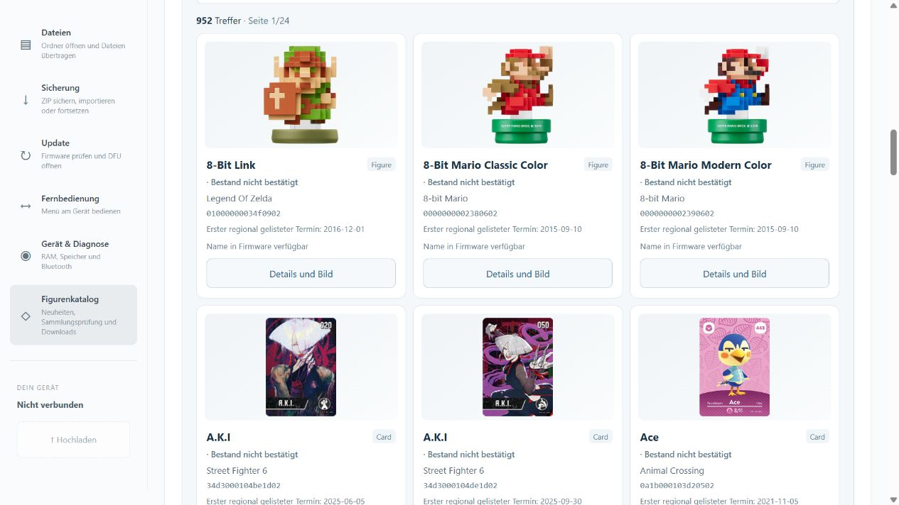
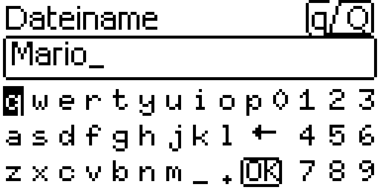

# DE3.56 und Dateimanager 3.34.0: bessere Eingabe und Bildergalerie

**Anwendung 2.22.0-DE3.56 / Zähler 628 · Dateimanager 3.34.0 · BL8 · Nordic S112 7.3.0 · Packed LittleFS PFS1**

Diese Version verbessert die Bedienung am LCD und im Browser. Sie korrigiert außerdem eine Inkonsistenz nach der Katalogaktualisierung: Gerätesuche, Auswahlvorschau, Dateieigenschaften und lokale Dateiprüfung verwenden jetzt denselben aktualisierten Sitzungskatalog wie der Figurenkatalog.

## Am Allmiibo

- **Beim Suchen und Umbenennen:** Die Tastatur zeigt auch bei leerem Feld das Zeichen, das ein kurzer Mitteldruck tatsächlich einfügt. Zuvor konnte sie einen Großbuchstaben anzeigen, obwohl ein Kleinbuchstabe eingefügt wurde.
- **Kurzer oder langer Mitteldruck:** Oben zeigt beispielsweise `q/Q` die Eingaben für kurz/lang an; `_/SP` bedeutet Unterstrich kurz und Leerzeichen lang. Die bestehende Eingabefunktion bleibt erhalten. Lange Titel werden so begrenzt, dass sie diese Hilfe nicht überdecken. Dafür wird kein zusätzlicher Heap-Speicher angefordert.
- **Listenposition:** Der Scrollbalken ist auch in großen Ordnern mindestens drei Pixel hoch und erreicht den Anfang bzw. das Ende der Leiste. Die Berechnung verwendet Ganzzahlen statt Fließkomma; leere Listen zeigen keinen irreführenden Positionsmarker.

## Im Dateimanager

1. **Figurenkatalog → Bilder anzeigen:** Eine optionale Galerie lädt Bilder nur für die aktuelle Seite. Vor dem Einschalten erfolgt kein Galerie-Bildabruf. Fehlende Bilder erhalten einen Platzhalter mit fester Fläche, damit die Karten nicht springen. Die Bildadressen sind an die aktive Katalogrevision gebunden. Der Abruf von GitHub übermittelt die öffentliche Figuren-ID und die IP-Adresse, keine Gerätedateien.
2. **Figurenkatalog → Bestand filtern:** Nach „Sammlung prüfen“ lassen sich vorhandene, nicht gefundene und auffällige Figuren sowie unbestätigte/veraltete Einträge gezielt anzeigen. Grün/Orange/Rot behalten ihre bisherigen Prüfregeln. Insbesondere wird eine Teilprüfung nicht als Nachweis fehlender Figuren behandelt; ein Ergebnis nach dem Trennen bleibt als frühere Beobachtung gekennzeichnet.
3. **Weiter/Zurück:** Ein bewusster Seitenwechsel führt zum Anfang der neuen Ergebnisse. Die Sucheingabe verschiebt weder Fokus noch Ansicht. Beim Seitenwechsel schließen sich alte Details, während die Galerieauswahl erhalten bleibt.
4. **Nach neuen Figuren suchen:** Übernommene Katalogdaten gelten jetzt auch unter „Auf dem Gerät suchen“, in der Auswahlvorschau, den Dateieigenschaften und „Eigene Figurendatei lokal prüfen“. Eine laufende Gerätesuche wird beim Katalogwechsel beendet und kann mit dem neuen Stand neu gestartet werden. Verspätete Ergebnisse/Bildfehler des alten Stands überschreiben nicht die neue Auswahl.

Der gebündelte Katalog enthält weiterhin **952 IDs**. Bilder und Katalogangaben sind keine Figurendateien; ein ID-Treffer bestätigt weder Signaturgültigkeit noch Spielunterstützung. Es wurde keine neue private BIN-Sammlung ergänzt.

## Downloads und Installation

- [Allmiibo_LCD_DE3_56_628_TESTSTAND.zip](https://github.com/bluecyber81/pixl.js/releases/download/de3.56/Allmiibo_LCD_DE3_56_628_TESTSTAND.zip): flashbare **Anwendung** für passende LCD/PFS1-Geräte. Das ZIP unverändert verwenden.
- [Allmiibo_Dateimanager_3_34_0.zip](https://github.com/bluecyber81/pixl.js/releases/download/de3.56/Allmiibo_Dateimanager_3_34_0.zip): portabler Dateimanager mit lokalem Startprogramm.
- [Allmiibo_DE3_56_Quellcode.zip](https://github.com/bluecyber81/pixl.js/releases/download/de3.56/Allmiibo_DE3_56_Quellcode.zip): Firmware-/Projektquellen und Entwicklerdokumentation.
- [Allmiibo_Dateimanager_3_34_0_Quellcode.zip](https://github.com/bluecyber81/pixl.js/releases/download/de3.56/Allmiibo_Dateimanager_3_34_0_Quellcode.zip): Browserquellen und Tests.
- [Allmiibo_DE3_56_Web3_34_0_Gesamtpaket.zip](https://github.com/bluecyber81/pixl.js/releases/download/de3.56/Allmiibo_DE3_56_Web3_34_0_Gesamtpaket.zip): Gesamtdownload mit Anleitung und Prüfsummen. **Das äußere Archiv ist nicht flashbar.**
- `SHA256SUMS.txt`: Prüfsummen der veröffentlichten Dateien.

[Online-Dateimanager](https://bluecyber81.github.io/pixl.js/) · [DFU-Seite für Anwendungen](https://bluecyber81.github.io/pixl.js/dfu/web.html) · [Bauanleitung](https://github.com/bluecyber81/pixl.js/blob/de3.56/docs/BUILD_DE3_56.md)

Die neuen Browserfunktionen benötigen kein Geräteupdate. Für die neue Tastaturdarstellung und Scrollleiste ist DE3.56 erforderlich. **BL8, Nordic S112 7.3.0 und das PFS1-Datenlayout bleiben unverändert.** Eine vorhandene passende Sammlung benötigt keine Formatierung oder Wiederherstellung. Alte DE3.8/DE3.16-SPIFFS-Geräte und normales Upstream-LittleFS benötigen weiterhin einen getrennten, passenden Migrationsweg; dieses ZIP stellt deren Speicher nicht um. Die [separaten BL8-/S112-Downloads](https://github.com/bluecyber81/pixl.js/releases/tag/bl8-s112-7.3.0) behalten ihre eigenen Installationsvoraussetzungen.

## Prüfung und Grenzen

Gezielte Regressionen prüfen die tatsächlichen Vue-Komponenten mit Katalogwechseln, Bildfreigaben, Filtern und Seitenwechseln sowie die Geräte-Texteingabe und Scrollanzeige in Host-Tests. Die abschließenden Ergebnisse gehören zum versionsgebundenen Prüfbericht; frühere DE3.55-Gerätebeobachtungen gelten nicht als Gerätetest von DE3.56. **Eine direkte Geräteprüfung dieser neuen Version steht noch aus.** Ein schnellerer Start oder neue Funk-/NFC-Funktionen werden für dieses Update nicht behauptet.

Die bisherigen Speicher-, Tasten-, Bluetooth-/NFC-, DFU-, Sicherungs- und Migrationsfunktionen bleiben Teil der Quellen. Private Schlüssel, Gerätesicherungen und Figurendateien sind nicht enthalten. Herkunft und Lizenzen von solosky, cylin577 und den Komponenten bleiben erhalten. [Ausführlicher Verlauf](https://github.com/bluecyber81/pixl.js/blob/de3.56/docs/DEVELOPMENT_HISTORY.de.md).

## Vorschau

Browseraufnahme ohne verbundenes Gerät; LCD-Darstellung aus Produktionscode und Originalschriften, keine Gerätefotografie.

