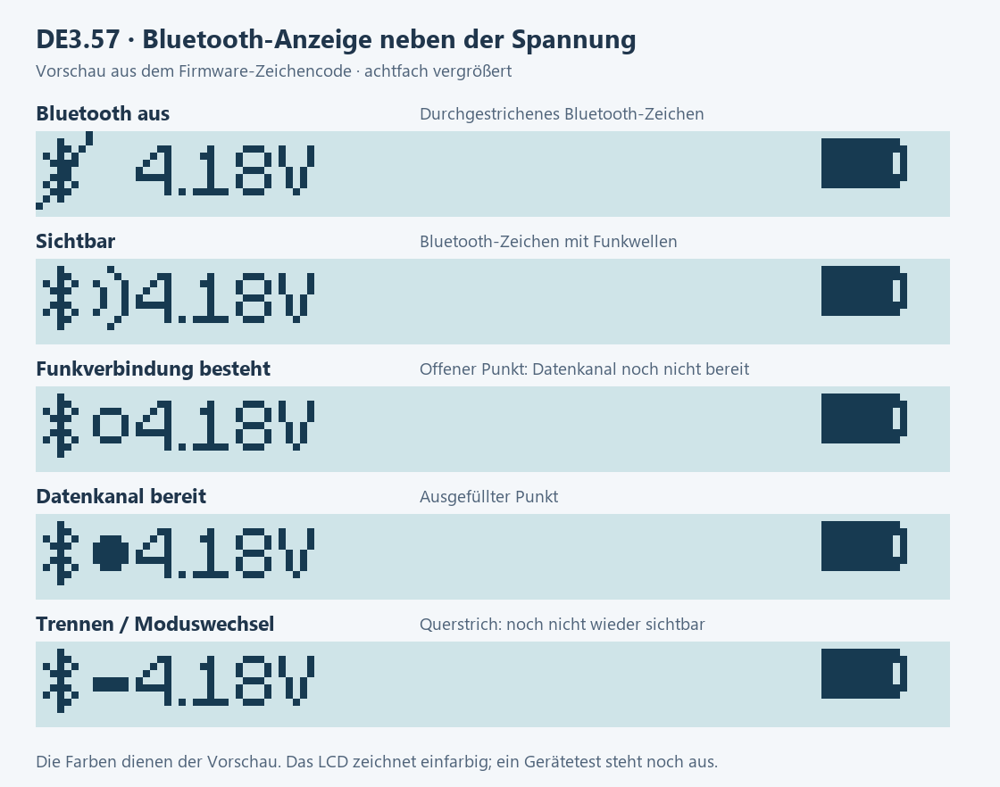
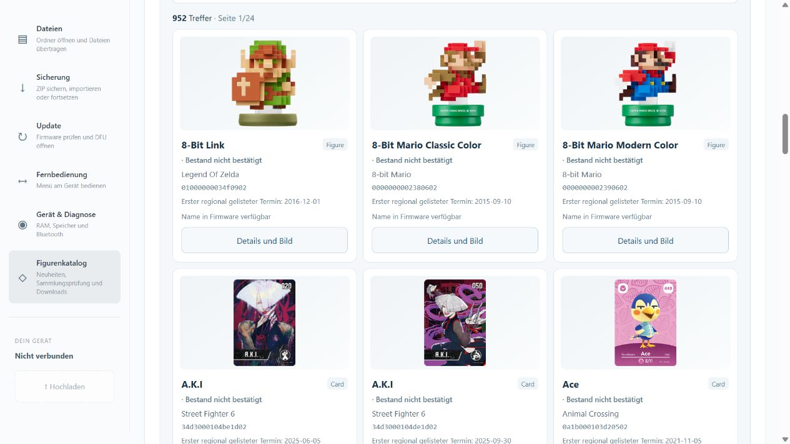
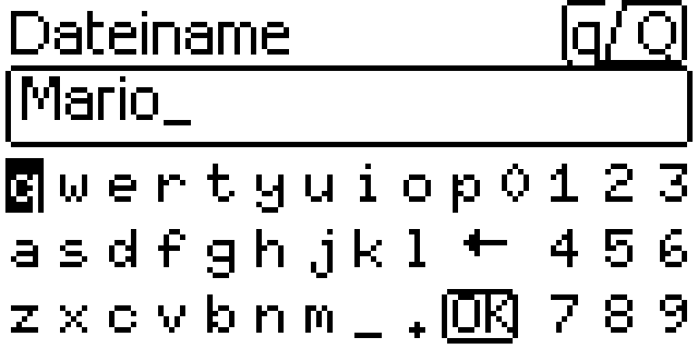

# Allmiibo LCD release notes

## File manager 3.49.0

On iPhone the file manager explains catalogue access and Bluetooth options. Comparing a folder again can identify files changed on both sides. Devices running cylin577 firmware have a dedicated PixLink connection option. [Release and downloads](https://github.com/bluecyber81/pixl.js/releases/tag/web3.49.0)

## File manager 3.48.4

The online catalogue check reports missing game notes and write support in the source. Reviewed notes remain available. The remote supports the keyboard and shows which command the device acknowledged. Dragoon and Hydra share a board code, so file inspection lists both possible machines. [Release and downloads](https://github.com/bluecyber81/pixl.js/releases/tag/web3.48.4)

## File manager 3.48.3

The offline catalogue contains 954 figure IDs. In **Figure catalogue → Game → Kirby Air Riders**, all seven riders appear, including Sword Kirby & Dragoon and Noir Dedede & Hydra. German names also find the matching cards. The firmware name filter covers the 952 IDs in the published App646. [Windows ZIP](https://github.com/bluecyber81/pixl.js/releases/download/web3.48.3/Allmiibo_Dateimanager_3_48_3_Portable.zip) · [Source ZIP](https://github.com/bluecyber81/pixl.js/releases/download/web3.48.3/Allmiibo_Dateimanager_3_48_3_Quellcode.zip)

## DE3.72 / App645 and file manager 3.48.1

The LCD test application restores the selected data slot and the figure last viewed in the detail screen. Four English and German game notes for Mipha and Urbosa have been corrected. File manager 3.48.1 adds App645 to the local capacity check. [Changes and validation](https://github.com/bluecyber81/pixl.js/releases/tag/de3.72) · [Open the file manager](https://bluecyber81.github.io/pixl.js/)

| Starting point on the LCD device | Download |
| --- | --- |
| Packed LittleFS is set up and Z19 and Nordic S112 7.3.0 are installed | [DE3.72 application only](https://github.com/bluecyber81/pixl.js/releases/download/de3.72/Allmiibo_LCD_DE3_72_645_NUR_APP.zip) |
| Compatible nRF52832 LCD, matching flash layout and working Secure DFU with the matching key. Bootloader counter below 19 and S112 FWID 0x0103 or 0x0126 | [Full S112 7.3.0, Z19 and DE3.72 package](https://github.com/bluecyber81/pixl.js/releases/download/de3.72/Allmiibo_LCD_S112_7_3_0_Z19_DE3_72_645_KOMPLETT.zip). Complete both stages with **nRF Device Firmware Update** on Android. |
| Older SPIFFS device to be migrated | [DE3.30-PREP / 600 preparation application](https://github.com/bluecyber81/pixl.js/releases/download/de3.72/Allmiibo_LCD_SPIFFS_DE3_30_PREP_600.zip). Back up existing files. Before switching the system, verify the complete Raw128 backup against the source device and run the local capacity check. [LittleFS migration guide](https://bluecyber81.github.io/pixl.js/guide/en.html#littlefs) |

The guide lists board and counter requirements. Initializing LittleFS erases the old E: drive. Restore the verified backup and complete the final comparison against the device. [Installation guide](https://bluecyber81.github.io/pixl.js/guide/en.html) · [Windows, sources and ChatGPT review kit](https://github.com/bluecyber81/pixl.js/releases/tag/web3.48.1)

## File manager 3.48.0 and LCD test firmware DE3.71t1

The file manager helps preserve completed backup ZIPs, exports filtered ZIP comparisons as CSV or JSON, and lets you move favourites and search filters between browsers. The Windows launcher now detects when its background server has stopped after an acknowledged shutdown.

On an LCD Allmiibo running App644, the tester reached the selected figure after Back to List and after sleep/wake on the paths exercised in the file emulator and the amiibo database. This signed application update is for compatible LCD units using Packed LittleFS. [Open the file manager](https://bluecyber81.github.io/pixl.js/) · [File manager downloads](https://github.com/bluecyber81/pixl.js/releases/tag/web3.48.0) · [LCD test firmware](https://github.com/bluecyber81/pixl.js/releases/tag/de3.71t1)

## File manager 3.47.0

The amiibo emulator sorts the displayed folder page once. With DE3.70, **Device & diagnostics → Read all diagnostic values** reports center-button events through the first main-menu selection and the duration of the app launch call. The record is held in RAM until restart. [LCD DE3.70 (ZIP)](https://bluecyber81.github.io/pixl.js/firmware/Allmiibo_LCD_DE3_70_642_NUR_APP.zip) · [Web 3.47.0](https://github.com/bluecyber81/pixl.js/releases/tag/web3.47.0)

## File manager 3.46.0

Under **Backup**, choose two saved backup ZIPs to see added, removed and changed entries, even while disconnected. Under **Update**, open a published LCD package in the Nordic DFU app on Android. The DE3.69 LCD test release lists the last five figures opened in the amiibo database. [DE3.69 LCD (ZIP)](https://bluecyber81.github.io/pixl.js/firmware/Allmiibo_LCD_DE3_69_641_NUR_APP.zip) · [Web 3.46.0](https://github.com/bluecyber81/pixl.js/releases/tag/web3.46.0)

## File manager 3.45.0 · LCD DE3.68 / 640 · 2026-11-09

Choose a game in the catalogue to see matching figures from your collection. In Backup, the folder comparison also lists files present only on the device. On the LCD, test firmware DE3.68 remembers the last opened app when returning to the main menu. You can give each connected device a name in this browser. Switching devices shows the name associated with the current connection. [DE3.68 LCD (ZIP)](https://bluecyber81.github.io/pixl.js/firmware/Allmiibo_LCD_DE3_68_640_NUR_APP.zip) · [Web 3.45.0](https://github.com/bluecyber81/pixl.js/releases/tag/web3.45.0)

## File manager 3.44.0 · 8 November 2026

When you open the file manager, it selects the first supported language in your browser’s preference list. Use the language menu to choose a fixed language or return to automatic selection.

The firmware updater, guide and download page also support German and English. The English interface now shows catalogue errors, report filenames and region names in English. Switching languages never renames any files on your device.

- **3.44.0** · [Web source (ZIP)](https://bluecyber81.github.io/pixl.js/downloads/web3.44.0/Allmiibo_Dateimanager_3_44_0_Quellcode.zip) · [ChatGPT review package (ZIP)](https://bluecyber81.github.io/pixl.js/downloads/web3.44.0/Allmiibo_DE3_67_Z19_Web3_44_0_ChatGPT_Pruefpaket.zip)

## File manager 3.43.1 · 8 November 2026

The local LittleFS capacity check shows DE3.67 with application counter 639 as the latest verified firmware. This storage profile covers DE3.55 through DE3.67.

- **3.43.1** · [Web source (ZIP)](https://bluecyber81.github.io/pixl.js/downloads/web3.43.1/Allmiibo_Dateimanager_3_43_1_Quellcode.zip) · [ChatGPT review package (ZIP)](https://bluecyber81.github.io/pixl.js/downloads/web3.43.1/Allmiibo_DE3_67_Z19_Web3_43_1_ChatGPT_Pruefpaket.zip)

## File manager 3.43.0 and LCD test release DE3.67 · 8 November 2026

Folder backups can resume after restarting the browser. The figure catalogue saves web favourites, named filters and HTTPS link lists. You can rotate an LCD capture by 180° before saving it. [User guide](docs/DATEIMANAGER_WEB.md#dateimanager-3430)

**LCD test release DE3.67 / 639.** All 54 distinct usage notes across 63 game associations can be read in German on the device. Long notes scroll to the last pixel. German game hints and the QR code were confirmed on the LCD. The renderer test covers the last scroll pixel. [Download for Android](https://bluecyber81.github.io/pixl.js/firmware/Allmiibo_LCD_DE3_67_639_NUR_APP.zip)

- **3.43.0** · [Web source (ZIP)](https://bluecyber81.github.io/pixl.js/downloads/web3.43.0/Allmiibo_Dateimanager_3_43_0_Quellcode.zip) · [ChatGPT review package (ZIP)](https://bluecyber81.github.io/pixl.js/downloads/web3.43.0/Allmiibo_DE3_67_Z19_Web3_43_0_ChatGPT_Pruefpaket.zip)

## File manager 3.42.2 · 8 November 2026

The illustrated shortcuts for figure import and firmware updates take up less space at the top. Both still open with one tap. On a phone you can download the web source or the ChatGPT review package for either 3.42.2 or 3.42.1. [Web 3.42.2](https://github.com/bluecyber81/pixl.js/releases/tag/web3.42.2) · [Web guide](docs/DATEIMANAGER_WEB.md#dateimanager-3422)

- **3.42.2** · [Web source (ZIP)](https://bluecyber81.github.io/pixl.js/downloads/web3.42.2/Allmiibo_Dateimanager_3_42_2_Quellcode.zip) · [ChatGPT review package (ZIP)](https://bluecyber81.github.io/pixl.js/downloads/web3.42.2/Allmiibo_DE3_66_Z19_Web3_42_2_ChatGPT_Pruefpaket.zip)
- **3.42.1 (previous release)** · [Web source (ZIP)](https://bluecyber81.github.io/pixl.js/downloads/web3.42.1/Allmiibo_Dateimanager_3_42_1_Quellcode.zip) · [ChatGPT review package (ZIP)](https://bluecyber81.github.io/pixl.js/downloads/web3.42.1/Allmiibo_DE3_66_Z19_Web3_42_1_ChatGPT_Pruefpaket.zip)

## File manager 3.42.1 · 8 November 2026

Two illustrated shortcuts open figure import and firmware updates on a phone. The six workspaces have distinct accent colours. Your device shows the current folder and a wide gradient bar for used storage. Figure import now opens on the first click even while the browser is still loading the view. The guide also covers Nordic’s desktop Bluetooth DFU option with a compatible adapter. [Web 3.42.1](https://github.com/bluecyber81/pixl.js/releases/tag/web3.42.1) · [Web guide](docs/DATEIMANAGER_WEB.md#dateimanager-3421)

## File manager 3.42.0 · 8 November 2026

Home now opens figure import or firmware updates directly. If a source blocks a catalogue download, open it in the browser and check the saved BIN. Download files directly from device search results and export the checked inventory as a CSV for Excel. [Web 3.42.0](https://github.com/bluecyber81/pixl.js/releases/tag/web3.42.0) · [Guide: firmware, bootloader and LittleFS](https://bluecyber81.github.io/pixl.js/guide/en.html)

## File manager 3.41.0 · 7 November 2026

Each catalogue entry can remember a direct HTTPS link to its BIN file. Click the figure name to download it. The browser checks the size, basic structure and figure ID first. [Web 3.41.0](https://github.com/bluecyber81/pixl.js/releases/tag/web3.41.0) · [Usage](docs/DATEIMANAGER_WEB.md#dateimanager-3410)

## File manager 3.40.1 · 7 November 2026

The updater preselects the package from its download card and clears the loaded ZIP when the selection changes. The catalogue filter includes the three series with announcements only. Completed backups report fresh and reused file counts and sizes. [Web release](https://github.com/bluecyber81/pixl.js/releases/tag/web3.40.1) · [LCD and Android backup observations](docs/validation/DE3_66_LCD_READBACK.md)

## DE3.66 / 638 and file manager 3.40.0 · 7 November 2026

The LCD test application supports display capture and can hash files up to 572 bytes on E: when resuming a backup. Web 3.40.0 adds nine figure announcements, inline search previews and estimated time remaining during DFU. Inventory still uses 952 confirmed figure IDs. DE3.65 / 637 is the stable application verified on LCD with Z19 and Nordic S112 7.3.0. Display capture, button input, menus and NFC on a Switch were confirmed on one LCD unit. An interrupted backup resumed over Windows Bluetooth and in Chrome on Android. [Features and installation](docs/RELEASE_DE3_66.md) · [Web downloads](https://github.com/bluecyber81/pixl.js/releases/tag/web3.40.0)

[Firmware and bootloader history](docs/VERSIONEN_FIRMWARE.md) · [File manager patch history](docs/VERSIONEN_WEB.md)

## DE3.65 final and file manager 3.39.5

Sync explains how to repeat a comparison when a device or local file has changed. Backup explains the limits of resuming. Web DFU and the phone download offer identical App637 bytes. An LCD device reported Z19 and Nordic S112 7.3.0. [LCD](docs/validation/DE3_65_LCD_READBACK.json) · [Web](docs/RELEASE_WEB3_39_5.de.md)

# DE3.65 / 637 and file manager 3.39.4

The LCD application corrects the three-line scrollbar and frees 2,672 bytes of program flash versus DE3.64. The file manager explains filename conflicts, translates the 54 distinct English catalogue hints into German and supports a screen wake lock during DFU. The signed app was accepted by Z19 with App636 in an ARM model. [Application and checks](https://github.com/bluecyber81/pixl.js/releases/tag/de3.65) · [Web release](https://github.com/bluecyber81/pixl.js/releases/tag/web3.39.4)

# File manager 3.39.3 · DFU completion and file names

File manager 3.39.3 reports when the browser requested the Bluetooth disconnect after a confirmed firmware transfer. During uploads, folder sync and renaming, length errors now identify the name or path, its size in UTF-8 bytes and the limit. After the device returns to its main menu, reconnect and check its reported firmware version under **Device & diagnostics**. [Usage and test evidence](docs/RELEASE_WEB3_39_3.de.md)

---

# DE3.63 / 635 · File manager 3.39.2

**Amiibo database → open figure → short centre press → Note / hints** makes the personal note and selected game's catalogue hint independently accessible. Short left/right changes between two pages, holding scrolls whole text lines, and centre returns to the menu. The same menu is available in the database slot view. Reading these pages changes no tag data, personal note, protection flag or save.

Eight existing German translations covering 13 catalogue associations are now also available in the firmware. Lookup requires the exact English source text; other available notes retain English. The hint depends on the selected database game. A missing hint does not establish game incompatibility.

**LCD rendering fix:** The production font now includes the previously missing uppercase umlauts **Ä, Ö and Ü**, including when used in personal notes. Existing glyphs are retained; this does not add support for all other Unicode characters.

Web 3.39.2 displays the bundled data version beside “Catalogue notes” in figure details and the selected-file preview. Existing screen-awake, backup and collection features remain included.

**Allmiibo_LCD_DE3_63_635_TESTSTAND.zip** updates only the application on matching LCD/PFS1 devices. It does not replace the bootloader, S112 or PFS1 and requires no new migration or formatting. No startup-speed improvement is claimed. Physical qualification of DE3.63 and extended phone/Bluetooth operation remain pending. A diagnostic export and positive user report dated 6 November 2026 now identify Z17 together with DE3.62; this does not qualify the new app. [Usage and limits](docs/RELEASE_DE3_63.md) · [Build](docs/BUILD_DE3_63.md) · [Web](docs/RELEASE_WEB3_39_2.de.md)

---

# Web 3.39.1 · Keep the screen awake during active operations

During backups, file transfers and longer device reads, the visible page requests a screen wake lock where supported. The status is visible, can be disabled, and offers an explicit retry. Completion, disconnect and unmount release it; returning to a visible tab requests it again. An OS release does not trigger an automatic retry loop.

Manual locking, browser suspension and power policies can still interrupt Bluetooth. No live device or Android qualification. App DE3.62/634, Z17 and S112 are unchanged. [Details](docs/RELEASE_WEB3_39_1.de.md).

# Web 3.39.0 · App DE3.62 / 634 unchanged

Locally prepared browser update dated 6 November 2026. Publication, a fresh personal backup and physical device testing are separate steps not established by these notes.

* **Figure details and selected-file preview:** Bundled notes for 952 figures and 1,344 associations. Eight partial German translations cover 13 associations; other available notes retain their English source. Associations are not game-test results.
* **Collection check:** Matching figure IDs are distinguished from SHA-256 file-content groups using bytes already read, without extra BLE reads. Quick mode makes no byte-equality claim; no automatic deletion.
* **Device & diagnostics → Inspect card slot locally:** An optional local repair copy requires a supported MF0 type, matching v8 configuration and `NN.bin`, the known legacy UID-copy pattern and valid BCC bytes. Original files remain intact; nothing is written to the device.
* **Import ZIP:** Exact inactive OLD/NEW journal files remain archived and are visibly excluded from restore. Active or unknown transactions block the whole import; source paths, remapped targets and fresh target state are checked.

App **DE3.62 / 634**, bootloader **Z17** and **S112 7.3.0** remain unchanged. [Usage and limits](docs/RELEASE_WEB3_39_0.de.md).

# DE3.61 · Web 3.37.4

**DE3.61 / 633** is a signed application update for the nRF52832 Allmiibo LCD with an existing Packed LittleFS (PFS1) volume, including the tested Z15 device configuration with Nordic S112 7.3.0. This application has passed computer-based checks. On-device testing of DE3.61 is pending.

* **Settings.** All 21 main settings and their values fit the German and English LCD layouts with menu animation disabled. The remote control state shows when it expires. The RAM overlay uses its drawing font to calculate text width.
* **Storage startup.** Mounting the same test image with 1,131 files and 77 directories took 4,531 flash reads instead of 4,712. **Device & diagnostics → Read startup times** now separates mounting, journal recovery and the rest of storage initialization.
* **Catalog.** More compact references leave 2,644 additional bytes free in application flash. The final image preserves all 952 figures, 82 games, 1,344 links and their localized descriptions.
* **File manager 3.37.4.** Diagnostics distinguish the firmware-reported ATT MTU from the usable transport value size. The version comparison recognizes Z15 and identifies the Z16 return package with its Z13 code separately.

[LCD comparison](docs/validation/DE3_61_LCD.png) · [Validation results](docs/validation/DE3_61.json)

# DE3.60 · Web 3.37.3

**DE3.60 / 632** improves the 128 × 64 LCD controls. The signed update contains the device application for the nRF52832 Allmiibo LCD with an existing Packed LittleFS (PFS1) volume.

* **Bluetooth file transfer.** Holding left or right changes the QR page once. The code opens the file manager on GitHub Pages. The status screen also shows the exit gesture.
* **On-screen keyboard.** Holding a letter enters one uppercase character. Holding Enter confirms once. Backspace still repeats. Use X to cancel without saving.
* **Settings.** Short values such as ON and OFF have a fixed column. Disabling animation still shows the title. A save error stays on screen for acknowledgement. A failed card export preserves the filename for retry.
* **Amiibo emulator → file menu → create multiple tags.** The display shows the file and its number in the batch. Cancel stops between committed files. Existing names, a full drive and insufficient RAM have distinct messages.
* **File manager 3.37.3 → Firmware update.** The page distinguishes transfer, checksum checks and final Execute acknowledgement. The running application version is confirmed separately after restarting.

## File manager 3.37.3

The DFU page shows when the bootloader receives application data, when the final checksum is checked, and when the bootloader acknowledges completion. You can then open the file manager to reconnect. Check the version in the device menu first. Interrupted transfers retain the last acknowledged byte count. [DFU instructions](docs/DATEIMANAGER_WEB.md)

## File manager 3.37.2

If Bluetooth disconnects during a figure upload, the file manager retains the affected paths and the original session. If the outcome is uncertain, reconnect the same device and check the destination folder before retrying. Keep the browser tab open to retain the notice. Switching devices clears the previous device’s success and error messages. Recovery notes still identify the original session. [GitHub Release](https://github.com/bluecyber81/pixl.js/releases/tag/web3.37.2)

## File manager 3.37.1

Collection scans and folder backups show Bluetooth read progress with an estimated countdown. Folder verification during a ZIP backup has a separate estimate. Combined device diagnostics show the section being read. Orange catalogue cards explain the specific warning for each figure. Reload the file manager in the browser to use it. [Web download](https://github.com/bluecyber81/pixl.js/releases/tag/web3.37.1)

## DE3.59 firmware and file manager 3.37.0

**DE3.59 / 631** is an application update for the nRF52832 Allmiibo LCD with an existing Packed LittleFS (PFS1) volume. **File manager 3.37.0** also supports older diagnostic reports. The BL8 bootloader, Nordic S112 7.3.0, on-disk format and catalog remain in place.

* **Startup reads.** The four existing cache pages now keep recently used block headers. Mounting the same synthetic collection (1,131 files, 77 directories) required 4,712 SPI reads instead of 4,802. The mount-only cache still needs 1,032 bytes. This measures reads, not elapsed time on hardware.
* **Card emulator → Slots → Slot count.** A failed save identifies a slot count that is still in RAM. A short center press retries without re-reading a card that was already saved; a long press returns and preserves the pending change for a later save.
* **Device diagnostics → Runtime.** DE3.59 reports the untouched portion of the reserved stack. In **Startup times → Compare multiple cold starts**, the browser calculates median and range from 3–20 reports of the same firmware.
* **Settings → Version → Source-ID.** The short source identifier for this release is `7b4822b045b4`. Two independent builds produced the same image. The catalog in that image contains 952 figure IDs, 82 games and 1,344 associations.

**LCD device measurement.** Across one start per version on the same unit, storage took 2,321 ms on DE3.59 and 2,338 ms on DE3.58. The first event was dispatched at 2,426 ms and 2,443 ms respectively. Both intervals were 17 ms shorter in this comparison. The markers exclude the bootloader and visible display response. During the Bluetooth read, the firmware reported 5,240 of 8,192 stack bytes untouched and 10,644 heap bytes free. [Device results](docs/validation/DE3_59_READBACK.json)

Existing PFS1 installations need no format or restore. Flash the inner firmware ZIP only. Physical power loss during bootloader activation and sleep current are not established by these tests.

[OTA](https://github.com/bluecyber81/pixl.js/releases/download/de3.59/Allmiibo_LCD_DE3_59_631_TESTSTAND.zip) · [Downloads](https://github.com/bluecyber81/pixl.js/releases/tag/de3.59) · [Tests](docs/validation/DE3_59.json) · [Build](docs/BUILD_DE3_59.md) · [S112](docs/validation/S112_7_3_0_VENDOR_READBACK.json)

---

# DE3.58 and file manager 3.36.0

**2.22.0-DE3.58 · DFU counter 630 · Allmiibo LCD with Packed LittleFS (PFS1)**

## On the Allmiibo

* **Card emulator → short middle press → Slot.** Cycling with left/right or selecting from the list now reports a failure to save the old card. In that case the old slot and its changed data remain in RAM. A failure to load the newly selected card has a separate error message.
* **Card emulator → short middle press → Slots Settings… → Slot Num…** With slot 50 selected, shrinking to eight slots could leave slot 50 active after an error on the second storage access. The emulator now saves the previous card once. Failure before a new slot is selected preserves the previous count and slot. Configuration and settings writes can be retried.
* **Card ID.** Pressing or holding the middle button on this information row no longer triggers a flash access.
* **Exiting, sleeping or restarting.** The emulator pauses NFC while it saves. If saving fails the app remains open. A short middle press retries and a long middle press returns to the previous view. Choose the intended action again after a successful retry. Cancelling preserves intentionally volatile Shadow state.
* **German menus.** Shorter labels cover firmware update, restart, wake on NFC/BLE, tag count and middle-button confirmation. **Settings → Info** lists bluecyber81 and cylin577.

## In the browser

1. For an optional device comparison, open **Device & diagnostics → Read all diagnostic values** in the file manager and read the boot information. Disconnect the file session before switching to DFU.
2. Open the **DFU page** and choose an application ZIP. Step 1 shows its application counter, hardware field and allowed SoftDevice FWIDs. A boot snapshot received within the previous ten minutes enables a comparison, including a lower counter or unexpected FWID. Without a snapshot, step 1 still displays the package data.
3. The page rejects mixed or contradictory initialization data before Bluetooth selection. The comparison does not verify LCD wiring or identify the device chosen in the subsequent Bluetooth dialog. Put the intended device in DFU mode and select it for transfer.

**Device & diagnostics → Read startup timings → Compare earlier startup report** compares the current six markers with a saved startup or combined diagnostic for the same device and a comparable collection. The browser handles the saved file locally. Negative differences in storage/application time mean faster. The markers exclude the bootloader and early SDK initialization.

With 1,131 synthetic files and 77 folders the host storage test took **4,802 physical reads instead of 5,181**, reducing reads by 379 and bytes read by 97,024. On 4 November, storage initialization on the same Allmiibo took **2,387 ms on DE3.58 versus 2,450 ms on DE3.57**. Time to first application dispatch was **2,490 versus 2,553 ms**. Both differences were 63 ms across one startup per version. The DFU page also compares SHA-256 of the entire BIN with the hash in its matching DAT.

In the NOR model, 100 saves of one unchanged 540-byte file required zero program or erase operations. When the last payload byte changed each time, the model still recorded 2,412 program operations and 279 erases. Comparing the changed bytes incurred extra reads. [Storage measurements](docs/validation/DE3_58_STORAGE.json).

## Downloads

- **Flash this inner application ZIP** as downloaded. [Allmiibo_LCD_DE3_58_630_TESTSTAND.zip](https://github.com/bluecyber81/pixl.js/releases/download/de3.58/Allmiibo_LCD_DE3_58_630_TESTSTAND.zip)
- **Portable file manager** with Windows launcher. [Allmiibo_Dateimanager_3_36_0.zip](https://github.com/bluecyber81/pixl.js/releases/download/de3.58/Allmiibo_Dateimanager_3_36_0.zip)
- **Full corresponding source** including firmware, tests and build instructions. [Allmiibo_DE3_58_Quellcode.zip](https://github.com/bluecyber81/pixl.js/releases/download/de3.58/Allmiibo_DE3_58_Quellcode.zip)
- **Web source** including browser tests. [Allmiibo_Dateimanager_3_36_0_Quellcode.zip](https://github.com/bluecyber81/pixl.js/releases/download/de3.58/Allmiibo_Dateimanager_3_36_0_Quellcode.zip)
- **Complete bundle** containing the four individual archives and checksums. Extract it to find the application ZIP. [Allmiibo_DE3_58_Web3_36_0_Gesamtpaket.zip](https://github.com/bluecyber81/pixl.js/releases/download/de3.58/Allmiibo_DE3_58_Web3_36_0_Gesamtpaket.zip)

## Compatibility and evidence

On matching LCD/PFS1 devices this is an application update. It requires no formatting or collection restore. SPIFFS and ordinary upstream LittleFS need a separate migration. BL8 and the Nordic SoftDevice have their own component documentation.

The built ARM image was checked for **952 figure IDs and 1,344 game mappings with three localized texts per mapping**. That comparison covers the firmware catalogue. To check a personal collection, connect the device and run the file manager's collection scan.

The final sources passed 141 firmware suites and 1131 browser host tests. The built pages passed 21 production checks at the root and 21 under the GitHub Pages path. The public ARM rebuild produced the same application bytes as the signed OTA.

The Allmiibo reported DE3.58/630, the BL8 fingerprint and Nordic S112 7.3.0 over Bluetooth. Its application heap had 10,668 bytes free, with a largest free block of 10,560 bytes. The settings matched the baseline byte for byte, and the root directory still contained nine entries. The owner confirmed card-slot switching and NFC recognition of a figure on Switch 2. Deliberate storage failure tests ran on the host. [DE3.58 device readback](docs/validation/DE3_58_READBACK.json) · [DE3.58 validation](docs/validation/DE3_58.json) · [DE3.57 device evidence](docs/validation/DE3_57_READBACK.json) · [BL8 and Nordic S112 evidence](docs/COMPONENTS.md) · [Build instructions](docs/BUILD_DE3_58.md).

---

# DE3.57 / file manager 3.35.1 – Bluetooth status at a glance

**LCD application 2.22.0-DE3.57 / counter 629 · file manager 3.35.1 · BL8 · Nordic S112 7.3.0 · Packed LittleFS PFS1**

A Bluetooth status indicator replaces the unchanging pictogram beside the voltage. It distinguishes inactive, advertising, a physical link without a ready data channel, a ready data channel, and disconnecting or switching mode. This also applies to optional remote-control connections, without enabling Bluetooth itself. See the [symbol guide](docs/BLUETOOTH_STATUS_DE3_57.md).

The indicator follows existing state changes, without extra radio queries, timers, animation or storage writes. “Data channel ready” does not mean a file is transferring or every remote command is permitted during NFC operation. The existing file-transfer screen retains its own status display.

File manager 3.35.1 carries the matching application OTA and compares the application against DE3.57. Diagnostics from 3.35.0 remain available. BL8, S112, PFS1 and existing collections are not replaced by this application update. Existing matching PFS1 devices need neither formatting nor restoration.

## Downloads

- [Allmiibo_LCD_DE3_57_629_TESTSTAND.zip](https://github.com/bluecyber81/pixl.js/releases/download/de3.57/Allmiibo_LCD_DE3_57_629_TESTSTAND.zip): application-only flashable OTA; use the unchanged ZIP.
- [Allmiibo_Dateimanager_3_35_1.zip](https://github.com/bluecyber81/pixl.js/releases/download/de3.57/Allmiibo_Dateimanager_3_35_1.zip): portable file manager.
- [Allmiibo_DE3_57_Quellcode.zip](https://github.com/bluecyber81/pixl.js/releases/download/de3.57/Allmiibo_DE3_57_Quellcode.zip): firmware/project source and developer documentation.
- [Allmiibo_Dateimanager_3_35_1_Quellcode.zip](https://github.com/bluecyber81/pixl.js/releases/download/de3.57/Allmiibo_Dateimanager_3_35_1_Quellcode.zip): browser source and tests.
- [Allmiibo_DE3_57_Web3_35_1_Gesamtpaket.zip](https://github.com/bluecyber81/pixl.js/releases/download/de3.57/Allmiibo_DE3_57_Web3_35_1_Gesamtpaket.zip): complete download; **the outer ZIP is not flashable**.

[Online file manager](https://bluecyber81.github.io/pixl.js/) · [DFU page](https://bluecyber81.github.io/pixl.js/dfu/web.html) · [Build guide](docs/BUILD_DE3_57.md) · [Validation](docs/validation/DE3_57.json)

## Validation scope

Host tests check state transitions and actual LCD rendering. Build and package checks are documented separately from device testing. **Physical validation of the new indicator is pending.** Earlier successful DE3.56 diagnostics are not relabelled as DE3.57 device tests. This release does not claim faster startup or greater radio range.

Enlarged preview from the firmware renderer, not a device photograph.

---

# File manager 3.35.0 – combined read-only diagnostics

Browser-only update. Firmware DE3.56/628, BL8 and S112 7.3.0 are unchanged.

Device & diagnostics → Read all diagnostic values collects eight sections sequentially. The combined report adds startup markers, RAM details, configured stack/cache sizes, firmware-reported MTU, storage geometry and the last settings-menu session, with per-section receipt times and partial failures. Unknown battery state and unsupported storage commands no longer produce misleading values/errors. No background reads, file changes, formatting or firmware flash.

[Online file manager](https://bluecyber81.github.io/pixl.js/) · [Downloads and source](https://github.com/bluecyber81/pixl.js/releases/tag/web3.35.0) · [Usage and limits](docs/DIAGNOSTICS_3_35.md)

A subsequent user-provided phone report confirms all eight diagnostic sections in 1.352 seconds without section errors. This is readback evidence, not a complete hardware or stress test. [Evidence and limits](docs/validation/WEB3_35_0_READBACK.json).

---

# DE3.56 and Dateimanager 3.34.0: clearer input and an image gallery

**LCD application 2.22.0-DE3.56 / counter 628 · Dateimanager 3.34.0 · BL8 · Nordic S112 7.3.0 · Packed LittleFS PFS1**

This release improves LCD and browser usability. It also fixes inconsistent catalogue use after an update: device search, selection previews, file properties and local file inspection now use the same updated session catalogue as the catalogue panel.

## On the Allmiibo

- **When searching or renaming:** Even in an empty field, each key displays the character inserted by a short middle press. Previously it could display an uppercase letter while inserting a lowercase letter.
- **Short/held middle press:** The header shows hints such as `q/Q` for short/held input or `_/SP` for underscore/space. Existing input behavior is preserved. Long titles are clipped so they cannot cover this hint; no additional heap allocation is needed.
- **List position:** The scrollbar thumb remains at least three pixels tall in large folders and correctly reaches both ends. Integer arithmetic replaces floating point; empty lists have no misleading position marker.

## In the file manager

1. **Figure catalogue → Show images:** An optional gallery loads images only for the current page. No gallery images are requested before opt-in. A fixed-size placeholder handles unavailable images. URLs are pinned to the active catalogue revision. GitHub receives the public figure ID and the visitor's IP address, not device files.
2. **Figure catalogue → Filter collection:** After a collection scan, select present, not found, needs inspection, or unconfirmed/outdated entries. Existing green/orange/red evidence rules remain intact: a partial scan cannot establish absence, and a result retained after disconnection remains labelled as an earlier observation.
3. **Next/Previous:** Explicit page changes reveal and focus the start of the new results. Typing does not move focus or scroll the view. Old details close on a page change; the gallery preference remains selected.
4. **Check for new figures:** Accepted catalogue data also applies to device-wide search, selection previews, file properties and local figure-file inspection. An in-progress device search stops when the catalogue changes and can be restarted with the new data. Late results or image errors from the old revision cannot replace the current selection.

The bundled catalogue still contains **952 IDs**. Catalogue entries and images are not figure files, and an ID match proves neither signature validity nor game compatibility. No private BIN collection has been added.

## Downloads and installation

- [Allmiibo_LCD_DE3_56_628_TESTSTAND.zip](https://github.com/bluecyber81/pixl.js/releases/download/de3.56/Allmiibo_LCD_DE3_56_628_TESTSTAND.zip): **application-only OTA** for matching LCD/PFS1 devices. Do not extract and re-zip it.
- [Allmiibo_Dateimanager_3_34_0.zip](https://github.com/bluecyber81/pixl.js/releases/download/de3.56/Allmiibo_Dateimanager_3_34_0.zip): portable file manager with a local launcher.
- [Allmiibo_DE3_56_Quellcode.zip](https://github.com/bluecyber81/pixl.js/releases/download/de3.56/Allmiibo_DE3_56_Quellcode.zip): firmware/project source and contributor documentation.
- [Allmiibo_Dateimanager_3_34_0_Quellcode.zip](https://github.com/bluecyber81/pixl.js/releases/download/de3.56/Allmiibo_Dateimanager_3_34_0_Quellcode.zip): browser source and tests.
- [Allmiibo_DE3_56_Web3_34_0_Gesamtpaket.zip](https://github.com/bluecyber81/pixl.js/releases/download/de3.56/Allmiibo_DE3_56_Web3_34_0_Gesamtpaket.zip): complete download with instructions and checksums. **The outer archive is not flashable.**
- `SHA256SUMS.txt`: published asset checksums.

[Online file manager](https://bluecyber81.github.io/pixl.js/) · [Application DFU page](https://bluecyber81.github.io/pixl.js/dfu/web.html) · [Build guide](https://github.com/bluecyber81/pixl.js/blob/de3.56/docs/BUILD_DE3_56.md)

The browser additions do not require a device update. DE3.56 is required for the new keyboard rendering and scrollbar. **BL8, Nordic S112 7.3.0 and the PFS1 storage layout are unchanged.** An existing compatible collection needs no format or restore. Old DE3.8/DE3.16/SPIFFS and ordinary upstream LittleFS still require their own migration path; this ZIP does not convert their storage. [Separate BL8/S112 downloads](https://github.com/bluecyber81/pixl.js/releases/tag/bl8-s112-7.3.0) retain their own installation requirements.

## Validation and limits

Targeted regressions exercise the production Vue components with catalogue replacement, image opt-in, filters and pagination, plus device text-entry and scrollbar rendering in host tests. Final outcomes belong in the version-specific validation report. Earlier DE3.55 device observations are not device tests of DE3.56. **Direct testing of this new release on the physical device is still pending.** This update claims neither a faster startup nor new radio/NFC functionality.

Existing storage, button, Bluetooth/NFC, DFU, backup and migration functionality remains in the source. Private keys, device backups and figure dumps are excluded. Attribution and licenses from solosky, cylin577 and component authors remain applicable. [Detailed history](https://github.com/bluecyber81/pixl.js/blob/de3.56/docs/DEVELOPMENT_HISTORY.md).

## Previews

Browser screenshot without a device; LCD render from production code and fonts, not a photograph.

