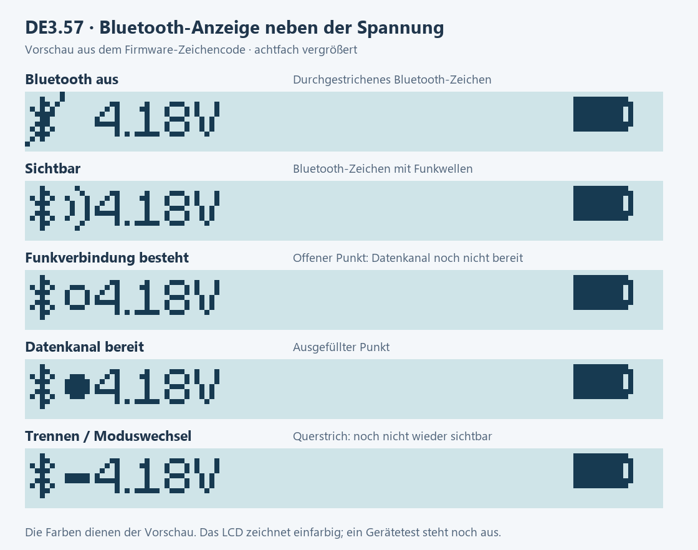

# Bluetooth-Anzeige in DE3.57 / Bluetooth indicator

Die Statusleiste zeigt links neben der Akkuspannung den vorhandenen Bluetooth-Zustand. Das bisherige statische Symbol aus der Siji-Schrift hatte dort keine Zustandsfunktion; seine ursprüngliche Bedeutung ist nicht dokumentiert. Die neue Anzeige ist eine kleine monochrome Pixelgrafik, kein frei konfigurierbares Logo.

| Markierung am Bluetooth-Symbol | Bedeutung |
| --- | --- |
| Durchgestrichen | Bluetooth ist inaktiv; das Gerät wirbt nicht um eine Verbindung. |
| Funkwellen | Das Gerät sendet sichtbar und kann von einem passenden Client gefunden werden. |
| Offener Punkt | Eine Funkverbindung besteht, aber der Datenkanal ist noch nicht bereit. |
| Gefüllter Punkt | Der Datenkanal der aktiven Sitzung ist bereit. |
| Kleines Minus | Trennung oder Moduswechsel läuft; noch keine erneute Sichtbarkeit oder Bereitschaft. |

## Vorschau

Vergrößerte Ausgabe des Firmware-Zeichencodes; keine Gerätefotografie. Farben dienen nur der Vorschau, das LCD zeichnet einfarbig.

## Verwenden

- **Bluetooth-Dateiübertragung** öffnen: Sobald das Gerät sichtbar sendet, erscheinen Funkwellen. Beim Verbinden folgt gegebenenfalls kurz der offene Punkt, dann der gefüllte Punkt.
- **Einstellungen → Fernbedienung (bis Aus)** einschalten: Die Anzeige spiegelt die tatsächlich aktive Verbindung auch außerhalb der Dateiübertragung wider. Das Symbol selbst erteilt keine Fernbedienungsfreigabe.
- Nach dem Trennen erscheinen Funkwellen nur, wenn das Gerät tatsächlich wieder sichtbar sendet. Wenn Bluetooth inaktiv ist, erscheint das durchgestrichene Symbol. Wird eine automatische Sitzungstrennung vom Funkstack abgelehnt, zeigt ein offener Punkt die verbliebene Funkverbindung ohne bereiten Datenkanal; die Anzeige behauptet dann keine noch laufende Trennung.
- Akkuspannung, Ladeanzeige und Akkusymbol behalten ihre bisherigen Aufgaben. Auf Ansichten ohne Statusleiste wird die neue Anzeige nicht zusätzlich eingeblendet.

## Was die Anzeige nicht beweist

Ein gefüllter Punkt bedeutet **Datenkanal bereit**, nicht „Dateiübertragung läuft“, erfolgreiche Befehlsausführung, NFC-Bereitschaft oder vollständige Prüfung der gespeicherten Figuren. Eine bloß eingeschaltete Fernbedienungsoption ist noch keine aktive Verbindung. Sicherheits-/Betriebsbedingungen können einen konkreten Fernbedienungsbefehl weiterhin zurückweisen, etwa während NFC-Arbeit.

Die Anzeige verwendet vorhandene Funk-/Sitzungszustände. Sie öffnet keine Verbindung, schreibt keine Einstellungen oder Dateien und erzeugt weder zusätzliche Funkabfragen noch einen Animationstimer. Neuzeichnen erfolgt bei Statusänderungen; normale andere Bildschirmaktualisierungen bleiben bestehen. Der einzelne bestehende Statusbeobachter der Dateiübertragungsansicht wird nicht durch die Statusleiste ersetzt.

## Installation und Prüfung

Benötigt die Anwendung **2.22.0-DE3.57 / Zähler 629** auf passender LCD/PFS1-Hardware. Dateimanager **3.35.1** enthält das zugehörige Anwendungsupdate; BL8, Nordic S112 7.3.0 und die PFS1-Speicherung bleiben erhalten. Es ist keine erneute Speicherumstellung vorgesehen.

Hosttests und die Vorschau prüfen die Produktions-Zustandsauswertung und Rasterausgabe. Am 03.11.2026 wurde DE3.57/Zähler 629 zusätzlich direkt am Gerät ausgelesen: BL8-Bereichs-Hash, S112 7.3.0, PFS1 und die Diagnoseantworten stimmen. Zwei erneute Verbindungen mit anschließendem Trennen und erneuter Sichtbarkeit bestanden; der Nutzer bestätigte danach die Funkwellen auf dem LCD. Die kurzen Leseprüfungen zeigten keine neuen RAM-, Warteschlangen-, Timeout- oder Dateisystemfehler. [Gerätenachweis](validation/DE3_57_READBACK.json), [Release-Nachweis](validation/DE3_57.json).

Noch nicht einzeln am Display bestätigt sind die übrigen Symbolzustände und die Anzeige in der Fernbedienung. Diese Leseprüfung war kein neuer NFC-, Tasten-, Schlaf-, Dauerlast- oder vollständiger Sammlungstest. Die gespeicherten Startmarker lagen bei 2.450 ms für den Speicher und 2.553 ms bis zum ersten Dispatch; Bootloader und früher SDK-Start sind darin nicht enthalten. Daraus wird keine Startbeschleunigung durch die neue Anzeige abgeleitet.

## English summary

The indicator beside the voltage uses a crossed Bluetooth mark for inactive, radio waves for advertising, an open dot for a physical link whose data channel is not ready, a filled dot for a ready active data channel, and a minus for disconnecting or switching mode. The readiness check also covers remote mode; a physical link alone is insufficient. There is no separate remote-permission symbol. Data-channel readiness is neither file-transfer activity nor permission to execute every remote/NFC operation.

The foreground UI follows existing state changes without extra radio queries, timers, animation, settings writes or filesystem changes. It does not replace the file-transfer screen's existing state observer. BL8, S112 and PFS1 are unchanged. Read-only DE3.57 device checks and two reconnect cycles passed on 2026-11-03; the user also confirmed the advertising waves after disconnect. Other LCD states and physical NFC/key/sleep tests remain separate from this bounded check.
