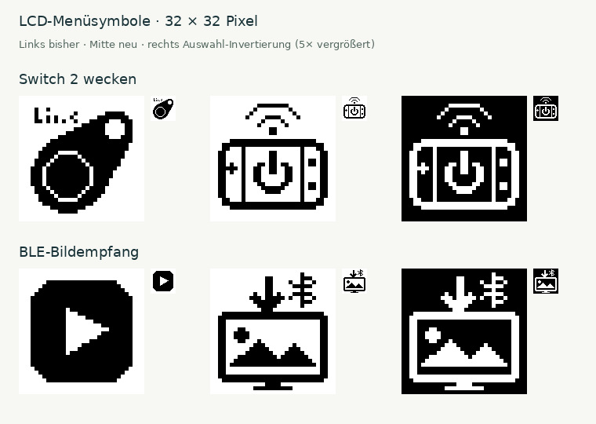

# LCD DE3.101 / App674 – passende Menübilder

App674 ergänzt eigene Symbole für **„Switch 2 wecken“** und **„BLE-Bildempfang“**. Ziel ist das LCD-Gerät mit ST7567, bestehendem PFS1, Z21 und S112 7.3.0. Das Update enthält ausschließlich die Anwendung.

## Was sich geändert hat

| Menü | Bisher | Neues Symbol |
|---|---|---|
| Switch 2 wecken | Wiederverwendetes Amiibo-Link-Symbol | Handheld mit Einschaltsymbol und Funksignal |
| BLE-Bildempfang | Allgemeines Player-Dreieck | Bildmonitor mit Empfangspfeil und Bluetooth-Zeichen |

Die Grafiken sind direkt im vorhandenen **32 × 32 Pixel großen, monochromen XBM-Format** gezeichnet. Dadurch braucht das Gerät weder Skalierung noch Farbumwandlung. Die ausgewählte Menüposition invertiert das Symbol wie bisher. Die Vorschau zeigt die tatsächlichen generierten Firmware-Bitmapbytes jeweils vergrößert und in Originalgröße:

Die acht übrigen Symbol-Bytearrays bleiben unverändert. Der Produktdiff enthält die beiden Bilder, ihre Zuordnung zu den LCD-Miniapps und die neue Versionskennung. BLE-Protokoll, Dateisystem, NFC-Verhalten, Bootloader und SoftDevice werden in diesem Schritt nicht geändert. Der Browser-Bildsender kann deshalb auch mit App673 verwendet werden; App674 wird für die neuen Menübilder benötigt.

Der OLED-Testzweig und das OLED-Paket wurden nicht verändert. Die zwei Miniapps sind weiterhin nur für LCD eingebunden. Daraus folgt keine pauschale Bytegleichheitsaussage für einen beliebigen zukünftigen OLED-Build aus diesem LCD-Zweig.

## Paket und Ressourcen

Datei: `Allmiibo_LCD_DE3_101_674_NUR_APP.zip` – **361.953 Bytes**.

SHA-256 des signierten ZIP:
`76a8c23a954a96a244b59b185fd147aae30f03b59017baa40d1aeeedb952dbca`

Anwendungs-BIN: **361.352 Bytes**, SHA-256:
`95161b30161e803275afe58b8f13193fe0421f6d2d34e5685840b15075a50052`

SourceID:
`894ab79ff45ee5c342d4fed11b6970fa0a60f21697216d4e876f488b4ba320f6`

Die zwei Bitmaps benötigen jeweils 128 Byte. Einschließlich ihrer Deskriptoren wächst die Anwendung gegenüber App673 um **272 Byte**. Die Flashreserve beträgt **11.372 Byte**. Der statische Heap-/Stackabstand bleibt bei **1.672 Byte**, der reservierte Stack bei **8.192 Byte**. Diese Werte stammen aus dem verknüpften Programm; sie sind keine neue Laufzeitmessung am Gerät.

Die PFS1-Enginekennung bleibt
`3ba6db5d72cb6c292beedd36b0b5126d4b63783ff054d07bcbc5c097d19ecd0f`.

## Softwareprüfungen

- Vollständige DE2-/DE3-Hostsuite: **197 von 197 Skripten bestanden**, keine ausgelassenen Skripte.
- Die BMP-Pixel werden gegen die generierten XBM-Bytes geprüft, einschließlich Orientierung, Bitreihenfolge, Vordergrundfarbe, Abmessungen und App-Zuordnung.
- Beide neuen Bitmaparrays und ihre 32×32-Deskriptoren wurden zusätzlich im tatsächlichen Release-ELF/BIN kontrolliert.
- **13 von 13** separaten Prüfgruppen am verknüpften Cortex-M4-Programm bestanden, unter anderem Menü, Stack, Kryptografie, Display und BLE.
- Zwei voneinander getrennte Builds mit gebundenem SDK und Compiler lieferten **identische BIN- und HEX-Dateien**.
- Signatur, Paketinhalt und drei Negativkontrollen bestanden. Release-ZIP und Web-DFU-ZIP sind bytegleich.
- Z21: sieben Prüfungen für Signatur, Hash und CRC sowie zwei Annahmefälle für App674 mit vorhandenem App673 beziehungsweise leerer Anwendungsbank bestanden.
- Die Wiederaufnahmeprüfung verwendete das vollständige neue App674-BIN. Sie umfasste 455 modellierte Stromabbrüche an Checkpoints, fünf Verbindungsabbrüche an Checkpoints und acht Annahme-/Abschlussfehler; die endgültigen Bytes wurden vollständig verglichen. ASan und UBSan bestanden. Lokales LSan ist durch die Ausführungsumgebung begrenzt; die aktuelle CI muss diesen Teil unabhängig bestätigen.

Präzise Ergebnisse und Veröffentlichungsstatus stehen in [DE3_101.json](validation/DE3_101.json). Private Quellinventare und persönliche Gerätedaten werden nicht mit diesem öffentlichen Nachweis veröffentlicht.

## Gerätebeobachtung und nächster Schritt

Der Nutzer meldete eine funktionierende Fernbedienung. Seine vorherige Diagnose meldet **App673 / DE3.100 auf LCD** mit passender Quellkennung. Diese Beobachtung wird dem tatsächlich beobachteten Vorgänger zugeordnet. Sie ist keine Messung des vollständigen laufenden BIN-Hashes und keine Abnahme von App674.

Nach Installation von App674 die beiden neuen Menüsymbole am LCD ansehen, jeweils öffnen und mit der Mitteltaste wieder verlassen. Für den Website-Bildsender anschließend ein Bild, ein kurzes Video, Invertierung, Stoppen und erneutes Verbinden prüfen. Tatsächliche Bildrate, Funkqualität und Energieaufnahme bleiben ohne Gerätebeobachtung offen.

Für den Handy-Download wird nach Veröffentlichung ein commitfester GitHub-Link mit geprüftem `Content-Type: application/zip` angeboten. Das signierte ZIP bleibt dabei unverändert.
